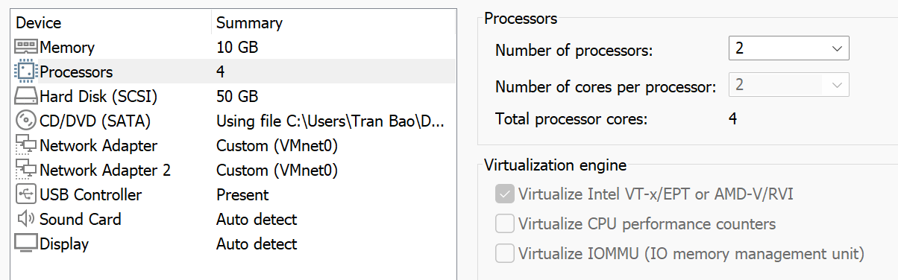
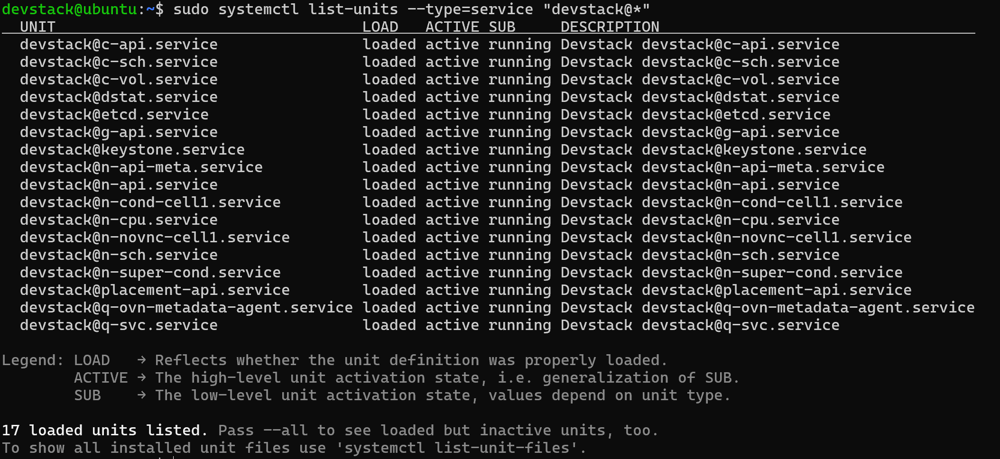

# CÀI ĐẶT OPENSTACK SỬ DỤNG CÔNG CỤ DEVSTACK
## Yêu cầu phần cứng
+ CPU: tối thiếu 4 vCores (hỗ trợ VT-x hoặc AMD-V)
+ RAM: tối thiếu 10GB (vì chạy OpenStack khá nặng)
+ Disk: tối thiếu 50-60GB (để thoải mái lab)
+ OS: ưu tiên Ubuntu Server 24.04 để tương thích với OpenStack tốt hơn
**Lưu ý:** nên bật tính năng Virtualize Intel VT-x/EPT or AMD-V/RVI để hiệu năng khi chạy được tốt nhất (nếu không thì rất lâu)

## Tiến hành cài đặt
- Trước khi cài OpenStack thì chúng ta phải cấu hình IP tĩnh và SSH cho VM trước
- Tiến hành cài đặt, cập nhật hệ thống và cài đặt Git:
```bash
sudo apt update && sudo apt upgrade -y
sudo apt install git net-tools -y
```
- Cấu hình quyền sudo không cần password cho user đang dùng
```bash
echo "ubuntu ALL=(ALL) NOPASSWD: ALL" | sudo tee /etc/sudoers.d/ubuntu
sudo chmod 0440 /etc/sudoers.d/ubuntu
```
- Download source DevStack phiên bản 2025.1
```bash
git clone https://opendev.org/openstack/devstack -b stable/2025.1
cd devstack
```
- Tạo file cấu hình tự động cài đặt `local.conf`, tại thư mục devstack/samples sẽ có sẵn file cấu hình mẫu, tiến hành copy ra thư mục devstack
```bash
cp samples/local.conf ./
```
- Sửa nội dung trong file, thay thế HOST_IP bằng IP thực tế của máy ảo
```bash
[[local|localrc]]
# Thông tin IP của máy ảo Ubuntu 24.04
HOST_IP=192.168.x.x  # <--- THAY BẰNG IP CỦA BẠN

# Mật khẩu chung cho tất cả các dịch vụ (Admin, Database, RabbitMQ)
ADMIN_PASSWORD=SecretOpenStack2025
DATABASE_PASSWORD=$ADMIN_PASSWORD
RABBIT_PASSWORD=$ADMIN_PASSWORD
SERVICE_PASSWORD=$ADMIN_PASSWORD

# Kích hoạt các dịch vụ lõi của OpenStack 2025.1
# Enable Horizon (Dashboard)
enable_service horizon
# Enable Cinder (Block Storage / Volume)
enable_service cinder c-sch c-api c-vol

# Cấu hình sử dụng KVM làm Hypervisor nội bộ nhờ đã bật Nested Virtualization
LIBVIRT_TYPE=kvm

# Bỏ qua việc tải các image mẫu quá nặng, sử dụng CirrOS mặc định cho nhẹ
DOWNLOAD_DEFAULT_IMAGES=True

# Log cài đặt
LOGFILE=$DEST/logs/stack.sh.log
LOGDAYS=2
```
- Tiến hành cài đặt, sử dụng câu lệnh sau (sau đó ngồi đợi tầm 30 phút tùy tình trạng của mạng):
```bash
./stack.sh
```
- Sau khi cài thành công, màn hình sẽ hiển thị ra thông báo như sau 
```console
Horizontal is now available at http://192.168.x.x/dashboard
Keystone is served at http://192.168.x.x/identity/v3
The project channels are available...
An admin RC file has been written to /home/stack/devstack/openrc
```
- Khi quá trình cài đặt đã diễn ra thành công, tiến hành kiểm tra các service của openstack đang chạy trên máy bằng câu lệnh
```bash
sudo systemctl list-units --type=service "devstack@*"
```

- Khi màn hình hiển thị ra như trên nghĩa là quá trình cài đặt đã thành công, bây giờ sẽ cùng phân tích các service kia là gì và có chức năng như thế nào nhé
**Keystone (Dịch vụ định danh)**
- Cách nhận biết: Chứa từ khóa keystone nguyên bản.
- Service trong danh sách:
    + devstack@keystone.service: Dịch vụ định danh trung tâm.
**Cinder (Dịch vụ lưu trữ khối)**
- Cách nhận biết: Bắt đầu bằng chữ c (viết tắt của Cinder).
- Các service trong danh sách:
    + devstack@c-api.service: Cinder API (tiếp nhận yêu cầu ổ đĩa).
    + devstack@c-sch.service: Cinder Scheduler (chọn node lưu trữ).
    + devstack@c-vol.service: Cinder Volume (tiến trình quản lý ổ đĩa thực tế).
**Glance (Dịch vụ hình ảnh)**
- Cách nhận biết: Bắt đầu bằng chữ g (viết tắt của Glance).
- Service trong danh sách:
    + devstack@g-api.service: Glance API (quản lý và cung cấp image hệ điều hành).
**Nova (Dịch vụ tính toán)**
- Cách nhận biết: Bắt đầu bằng chữ n (viết tắt của Nova).
- Các service trong danh sách:
    + devstack@n-api.service: Nova API.
    + devstack@n-api-meta.service: Nova Metadata API.
    + devstack@n-sch.service: Nova Scheduler (chọn máy chủ đặt máy ảo).
    + devstack@n-cond-cell1.service & n-super-cond.service: Nova Conductor (giao tiếp cơ sở dữ liệu).
    + devstack@n-cpu.service: Nova Compute (tiến trình quản lý KVM/máy ảo trên node).
    + devstack@n-novnc-cell1.service: Nova noVNC Proxy (truy cập màn hình console máy ảo).
**Neutron (Dịch vụ mạng)**
- Cách nhận biết: Bắt đầu bằng chữ q (bắt nguồn từ tên cũ của Neutron là Quantum).
- Các service trong danh sách:
    + devstack@q-svc.service: Neutron Server (dịch vụ mạng cốt lõi).
    + devstack@q-ovn-metadata-agent.service: OVN Metadata Agent (hỗ trợ phân giải metadata mạng tích hợp OVN).
**Các service bổ trợ khác:**
+ devstack@etcd.service: Hệ thống cơ sở dữ liệu khóa-giá trị phân tán (thường được OVN sử dụng để đồng bộ trạng thái).
+ devstack@placement-api.service: Dịch vụ Placement (theo dõi tài nguyên CPU/RAM của Nova để scheduler phân bổ chính xác).
+ devstack@dstat.service: Công cụ giám sát hiệu năng hệ thống (CPU, RAM, Disk) đi kèm của DevStack.

## Cấu hình 1 VM trên OpenStack
- Đầu tiên ta sẽ cần đẩy image lên OpenStack, tiến hành tải file Ubuntu Server
```bash
# Ví dụ tải bản Ubuntu 22.04 LTS Cloud Image
wget https://cloud-images.ubuntu.com/jammy/current/jammy-server-cloudimg-amd64.img -O ubuntu-22.04-server.qcow2
```
- Tiến hành đẩy image lên OpenStack
```bash
openstack image create "ubuntu-server-22.04" \
  --file ubuntu-22.04-server.qcow2 \
  --disk-format qcow2 \
  --container-format bare \
  --public
```
- Bây giờ tiến hành tạo Network, tại menu bên trái Project > Network > Network, chọn Create Network
    + Thẻ Network: Đặt tên là Bao-Network
    + Thẻ Subnet: đặt tên subnet là Bao-Subnet, điền dải IP là 10.0.0.0/24, Gateway IP là 10.0.0.1
    + Thẻ Subnet Details: Điền địa chỉ 8.8.8.8 vào phần DNS Name Servers
- Tiến hành tạo Router, Project > Network > Routers, nhấn Create Router
    + Đặt tên là Bao-Router
    + Tại mục External Network, chọn mạng `public`, nhấn Create Router
    + Click vào tên Router vừa tạo, vào tab Interface > nhấn Add Interface và chọn dải đúng dải Bao-Network (10.0.0.0/24) vừa tạo
    + Kiểm tra mô hình mạng tại Network Topology
- Khởi tạo Volume, Project > Volumes > Volumes, nhấn Create Volume
    + Volume Name: Bao-Volume
    + Volume Source: chọn Image và chọn vào image `ubuntu-server-22.04` vừa tạo
    + Size: tùy chọn, ở đây để 20GB
- Tiến hành tạo máy ảo, Project > Compute > Instance, chọn Launch Instance
    + Details: Đặt tên cho VM là Bao-VM
    + Source: Select Boot Source chọn Volume và chọn Volume `Bao-Volume` vừa tạo
    + Flavor: chọn cấu hình đủ dùng
    + Network: chọn dải `Bao-Network` vừa tạo
- Tại phần Configuration, cấu hình cloud-init (nếu không sẽ không đăng nhập được :'D), nhập script ở bên dưới vào:
```bash
#cloud-config
users:
  - name: tranbao
    sudo: ALL=(ALL) NOPASSWD:ALL
    groups: users, admin, sudo
    shell: /bin/bash
    lock_passwd: false
    plain_text_passwd: "123456@"

ssh_pwauth: true
chpasswd:
  expire: false
```
- Nhấn Launch Instance, đợi khởi tạo máy ảo
- Sau khi máy ảo tạo xong thì nhấn vào tên máy ảo, chuyển qua tab Console và tiến hành đăng nhập rồi sử dụng :'D