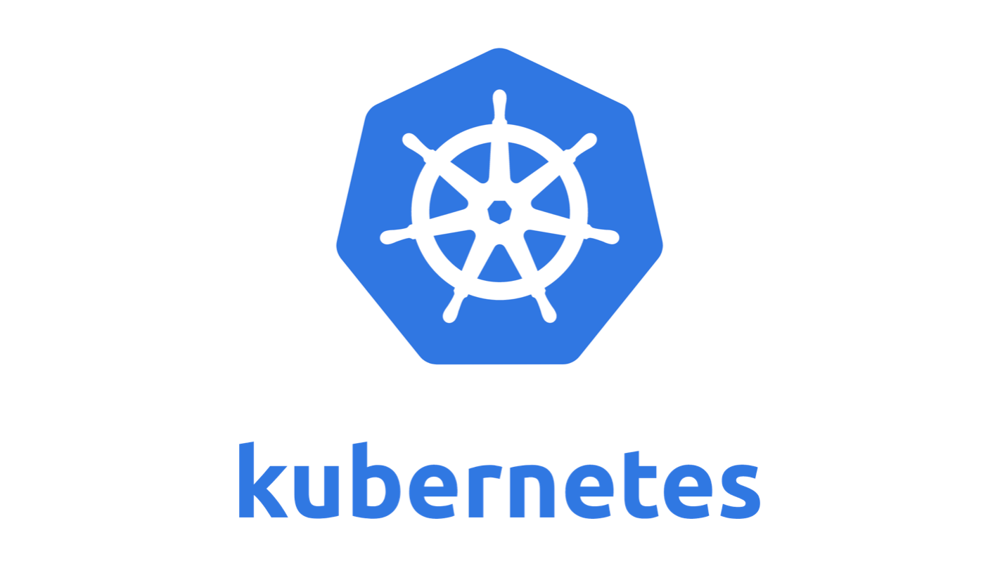
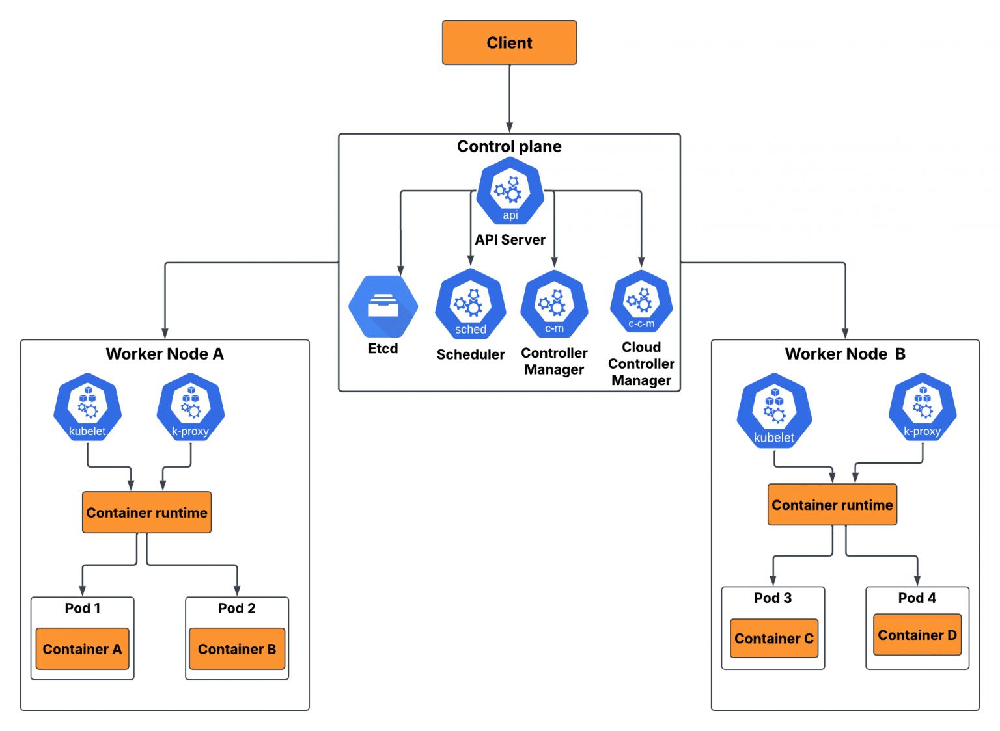

# TÌM HIỂU VỀ KUBERNETES (K8S)
## Khái niệm
- Kubernetes (thường được gọi là K8s) là một nền tảng điều phối container mã nguồn mở (open-source container orchestration platform), hoạt động như một hệ điều hành cho đám mây (cloud operating system) giúp quản lý và vận hành các containerized applications trên nhiều máy chủ trong cùng một Kubernetes Cluster. Mục tiêu chính của Kubernetes là tự động hóa toàn bộ vòng đời ứng dụng container hóa, bao gồm việc triển khai, mở rộng quy mô (scaling), phục hồi lỗi (self-healing), khám phá dịch vụ (service discovery) và cân bằng tải (load balancing). Hiểu đơn giản, Kubernetes giống như một “hệ điều hành” chạy trên nhiều máy chủ, giúp bạn quản lý các ứng dụng dễ dàng hơn.

## Các thuật ngữ phổ biến trong Kubernetes
- **Kiến trúc tổng thể**

| Thuật ngữ | Khái niệm và vai trò |
|:---:|:---:|
| Cluster | Kubernetes Cluster (cụm Kubernetes) là một tập hợp các máy tính (nodes) hoạt động phối hợp để triển khai và quản lý ứng dụng container hóa. Cụm bao gồm một Master Node chịu trách nhiệm điều khiển, phân phối tài nguyên và giám sát, cùng với nhiều Worker Nodes trực tiếp chạy các ứng dụng. Nhờ cơ chế tự động hóa triển khai, mở rộng quy mô và quản lý container, Cluster đảm bảo ứng dụng hoạt động ổn định, linh hoạt và dễ dàng thích ứng trên nhiều môi trường khác nhau, từ on-premise đến cloud-native infrastructure |
| Node | Node trong Kubernetes là một server vật lý hoặc máy ảo trong cụm (cluster), cung cấp tài nguyên tính toán như CPU và RAM để chạy các ứng dụng container hóa thông qua Pods. Mỗi Node được trang bị các thành phần cốt lõi như Kubelet (quản lý Pods và container), Container Runtime (thực thi container), và Kube-proxy (xử lý mạng), nhằm đảm bảo khả năng giao tiếp với control plane và duy trì hoạt động ổn định của các container. |
| Master Node | Master Node (hay Nút chính) là máy chủ trung tâm chịu trách nhiệm quản lý và điều phối toàn bộ cụm (cluster) trong các hệ thống phân tán như Kubernetes. Trong Kubernetes, Master Node đóng vai trò như “bộ não” của cụm, điều khiển control plane, giám sát các Worker Nodes và duy trì trạng thái mong muốn (desired state) của hệ thống. |
| Worker Node | Worker Node trong Kubernetes (hay Nút công nhân) là máy chủ vật lý hoặc máy ảo trong cụm, nơi các ứng dụng thực tế được chạy dưới dạng Pods. Mỗi Worker Node bao gồm ba thành phần chính: Container Runtime (ví dụ: Docker) để thực thi container, Kubelet để giao tiếp với Master Node và quản lý Pods, cùng Kube-proxy để xử lý mạng và cân bằng tải, đảm bảo ứng dụng hoạt động ổn định và hiệu quả. |

- **Workloads và Đơn vị triển khai**

| Thuật ngữ | Khái niệm và vai trò |
|:---:|:---:|
| Image | Image là một gói thực thi độc lập, bất biến (immutable), chứa toàn bộ thành phần cần thiết để chạy ứng dụng, bao gồm mã nguồn, runtime, thư viện, cấu hình và dependencies. Các Pods trong Kubernetes sử dụng container image này để khởi tạo và chạy containers, giúp ứng dụng hoạt động nhất quán, ổn định và có thể tái tạo trên mọi môi trường, từ máy tính cá nhân đến hạ tầng đám mây (cloud environment). |
| Container | Container là đơn vị phần mềm nhẹ, độc lập, chứa toàn bộ thành phần cần thiết để chạy ứng dụng, bao gồm mã nguồn, thư viện, công cụ và tệp cấu hình, giúp ứng dụng vận hành nhất quán trên nhiều môi trường. Là một nền tảng điều phối container mã nguồn mở (open-source container orchestration system), K8s sử dụng các container làm nền tảng để triển khai, quản lý, mở rộng và tự động hóa ứng dụng, mang lại tính linh hoạt và độ sẵn sàng cao cho hệ thống. Trong kiến trúc Kubernetes, container không chạy trực tiếp trên cluster mà được đóng gói bên trong Pod. Mỗi Pod có thể chứa một hoặc nhiều container và được triển khai trên Worker Nodes trong Kubernetes Cluster. Nhờ mô hình này, K8s có thể quản lý tài nguyên, networking và lifecycle của container một cách nhất quán. |
| Pod | Pod trong Kubernetes (K8s) là đơn vị triển khai nhỏ nhất (smallest deployable unit), có thể chứa một hoặc nhiều container cùng chạy trên một Node. Các container trong cùng một Pod chia sẻ tài nguyên hệ thống như bộ nhớ, mạng và lưu trữ, đồng thời sử dụng một địa chỉ IP chung, cho phép chúng giao tiếp hiệu quả qua localhost và hoạt động như một thực thể logic duy nhất. |

- **Đối tượng Quản lý và Tự động hóa**

| Thuật ngữ | Khái niệm và vai trò |
|:---:|:---:|
| Deployment | Kubernetes Deployment là một tài nguyên khai báo (declarative resource) cho phép định nghĩa trạng thái mong muốn của ứng dụng, và K8s sẽ tự động quản lý quá trình triển khai, cập nhật và duy trì số lượng Pod replicas trên cụm. Deployment hỗ trợ cập nhật linh hoạt (rolling updates), cho phép rollback khi có lỗi, đồng thời tự động thay thế các Pod hỏng để đảm bảo tính sẵn sàng cao cho ứng dụng. |
| Service | Service là một lớp trừu tượng mạng (networking abstraction) cung cấp điểm truy cập ổn định (stable endpoint) cho các Pod, thông qua một địa chỉ IP và tên DNS duy nhất. Service hoạt động như cầu nối mạng, cho phép người dùng truy cập một nhóm Pod chạy cùng ứng dụng mà không cần quan tâm đến địa chỉ IP động của từng Pod, đồng thời cung cấp cân bằng tải (load balancing) để đảm bảo hiệu năng và tính sẵn sàng cao. |
| Label | Label trong Kubernetes là một cặp khóa–giá trị (key–value pair) gắn vào các đối tượng như Pod, Node, Service để cung cấp metadata, hỗ trợ phân loại và tổ chức tài nguyên trong cụm. Kubernetes K8s sử dụng labels kết hợp với selectors để lọc, truy vấn và nhóm đối tượng thành các tập hợp con, giúp người dùng thao tác hàng loạt, quản lý và điều phối tài nguyên một cách hiệu quả hơn. |
| Namespace | Kubernetes Namespace (Không gian tên) là một cơ chế phân vùng logic (logical partition) trong cụm, cho phép nhóm và cô lập tài nguyên thành các “cụm ảo” (virtual clusters) để phục vụ nhiều người dùng, dự án hoặc môi trường (dev, staging, production) trên cùng một hạ tầng vật lý. Namespace cung cấp phạm vi tên (naming scope), cho phép các tài nguyên có cùng tên nhưng tồn tại trong các namespace khác nhau mà không gây xung đột, đồng thời hỗ trợ tổ chức, quản lý và chia sẻ tài nguyên hiệu quả trong hệ thống. |

- **Các thành phần Cốt lõi và Công cụ**

| Thuật ngữ | Khái niệm và vai trò |
|:---:|:---:|
| API Server | API Server trong Kubernetes (kube-apiserver) là thành phần trung tâm của Control Plane, đóng vai trò giao diện chính để người dùng, nhà phát triển và các thành phần nội bộ tương tác với hệ thống.   API Server cung cấp RESTful API để tiếp nhận yêu cầu, thực hiện xác thực, xử lý logic và cập nhật trạng thái tài nguyên trong cụm, bao gồm Pod, Service, Deployment và nhiều đối tượng khác |
| Etcd | Etcd trong Kubernetes là một kho lưu trữ khóa–giá trị phân tán (distributed key–value store), đóng vai trò nguồn dữ liệu trung tâm để lưu trữ trạng thái, cấu hình và metadata của toàn bộ cụm.   Etcd đảm bảo tính nhất quán, độ bền và khả dụng cao bằng cách chạy trên một cụm node phân tán, cho phép các thành phần như API Server truy cập, theo dõi và quản lý hiệu quả tài nguyên trong hệ thống Kubernetes. |
| Scheduler | Kubernetes Scheduler (Kube-scheduler) là thành phần thuộc Control Plane, chịu trách nhiệm lựa chọn và phân bổ Pods lên các Nodes phù hợp trong cụm. Nó đánh giá các yếu tố như yêu cầu tài nguyên (CPU, bộ nhớ), ràng buộc phần cứng, chính sách và tính tương thích để xác định Node tối ưu. Sau đó, quyết định này được chuyển cho Kubelet trên Node đã chọn để khởi chạy Pod. |
| Controller Manager | Controller Manager là một thành phần của Control Plane, hoạt động liên tục theo cơ chế vòng lặp điều khiển (control loop) để giám sát và điều chỉnh trạng thái hiện tại của cụm sao cho khớp với trạng thái mong muốn (desired state) được định nghĩa trong cấu hình khai báo.   Thành phần này hỗ trợ việc quản lý nhiều controllers chuyên biệt, mỗi controller đảm nhiệm một tác vụ cụ thể như duy trì số lượng Pod replicas, quản lý Nodes, tạo Service Accounts hoặc xử lý background jobs. |
| Kubelet | Kubelet là một tác nhân nút (node agent) chạy trên mỗi Worker Node, chịu trách nhiệm giao tiếp với Control Plane và quản lý containers. Nhiệm vụ chính của Kubelet là nhận thông tin về Pods cần triển khai, khởi chạy và giám sát containers trên Node đó, đồng thời báo cáo trạng thái Pods và tài nguyên về cho Control Plane để đảm bảo hệ thống vận hành ổn định. |
| Kubectl | Kubectl là một công cụ dòng lệnh (CLI) dùng để tương tác với cụm Kubernetes thông qua việc gửi lệnh quản lý, triển khai và giám sát các ứng dụng container hóa. Về bản chất, kubectl chính là giao diện người dùng của Kubernetes, dựa trên Kubernetes API để thực thi mọi thao tác trên cluster, từ tạo và cập nhật tài nguyên cho đến điều phối lưu lượng. |

## Kiến trúc của Kubernetes (Kubernetes Architecture)
- Kiến trúc Kubernetes (Kubernetes Architecture) bao gồm hai phần cốt lõi: `Control Plane` và `Worker Nodes`. Control Plane chịu trách nhiệm quản lý, điều phối và duy trì trạng thái mong muốn của toàn bộ cụm (cluster), trong khi Worker Nodes là nơi các ứng dụng container được triển khai và vận hành thực tế.

### Control Plane
- Control Plane là trung tâm điều hành, đảm bảo hệ thống hoạt động ổn định và tuân thủ theo các cấu hình khai báo. Nó bao gồm nhiều thành phần hợp tác chặt chẽ:
    + `API Server (kube-apiserver)`: Là cổng giao tiếp chính của Kubernetes, tiếp nhận tất cả các yêu cầu từ người dùng (qua công cụ dòng lệnh kubectl, dashboard, hoặc các dịch vụ khác). API Server xử lý xác thực, kiểm tra tính hợp lệ và truyền lệnh đến các thành phần khác trong Control Plane.
    + `Etcd`: Một kho lưu trữ key-value phân tán có tính nhất quán cao, lưu trữ toàn bộ dữ liệu cấu hình, thông tin tài nguyên và trạng thái cụm. etcd được xem là “single source of truth”, đảm bảo dữ liệu luôn sẵn sàng và bền vững ngay cả khi hệ thống gặp sự cố.
    + `Scheduler (kube-scheduler)`: Chịu trách nhiệm theo dõi các Pod mới được tạo nhưng chưa có Node gán. Scheduler đánh giá nhiều yếu tố như nhu cầu CPU, bộ nhớ, ràng buộc phần cứng, affinity/anti-affinity và chính sách ưu tiên để chọn Worker Node tối ưu cho Pod.
    + `Controller Manager (kube-controller-manager)`: Quản lý nhiều controller nhỏ chạy song song để duy trì trạng thái mong muốn.
    + `Cloud Controller Manager`: Dành cho môi trường cloud, thành phần này tích hợp Kubernetes với các dịch vụ của nhà cung cấp như AWS, GCP hoặc Azure. Nó quản lý các tài nguyên hạ tầng như Load Balancer, Node, Persistent Volume và đảm bảo Kubernetes có thể khai thác sức mạnh của đám mây một cách tự động.

### Worker Nodes
- Worker Nodes là nơi toàn bộ ứng dụng container thực sự chạy. Mỗi Node có thể là một máy ảo hoặc máy chủ vật lý, bên trong bao gồm các thành phần chính:
    + `Kubelet`: Một agent chạy trên mỗi Node, nhận lệnh từ API Server thông qua Control Plane. Kubelet đảm bảo rằng Pod và container đang chạy đúng như mô tả trong file khai báo, đồng thời báo cáo trạng thái Node và Pod về cho Control Plane.
    + `Kube-proxy`: Thành phần mạng trên mỗi Node quản lý định tuyến và cân bằng tải. Nó duy trì kết nối giữa các dịch vụ và Pod, đồng thời áp dụng quy tắc iptables/IPVS để định tuyến lưu lượng đến Pod chính xác.
    + `Container Runtime`: Phần mềm chịu trách nhiệm chạy các container. Kubernetes hỗ trợ nhiều runtime khác nhau như Docker, containerd, CRI-O, mang đến sự linh hoạt trong triển khai và vận hành.

### Các thành phần bổ sung khác
- Ngoài Control Plane và Worker Nodes, Kubernetes còn có nhiều thành phần bổ sung để mở rộng khả năng quản lý và vận hành:
    + `Cluster`: Là tập hợp bao gồm Control Plane và tất cả Worker Nodes, hợp thành một cụm Kubernetes hoàn chỉnh. Đây là môi trường nơi các ứng dụng container hóa được triển khai và mở rộng.
    + `Pod`: Đơn vị triển khai nhỏ nhất của Kubernetes, chứa một hoặc nhiều container. Các container trong cùng một Pod chia sẻ tài nguyên như mạng, lưu trữ và có cùng địa chỉ IP, giúp chúng giao tiếp hiệu quả với nhau như một thực thể logic duy nhất.
    + `Add-ons`: Các thành phần mở rộng nhằm tăng cường chức năng cho cụm.

## Chức năng chính của Kubernetes
- Giải pháp quản lý container Kubernetes bao gồm 10 chức năng chính:
    + Service discovery and load balancing (Dịch vụ cân bằng tải)
    + Storage orchestration (Điều phối lưu trữ)
    + Automated rollouts and rollbacks (Tự động triển khai và hoàn nguyên)
    + Automatic bin packing (Tối ưu hóa phân bổ tài nguyên)
    + Self-healing (Tự động phục hồi)
    + Secret and configuration management (Quản lý cấu hình và thông tin nhạy cảm)
    + Batch execution (Xử lý theo lô)
    + Horizontal scaling (Tự động mở rộng ngang)
    + IPv4/IPv6 dual-stack (Hỗ trợ dual-stack IPv4/IPv6)
    + Designed for extensibility (Thiết kế mở rộng)

### Dịch vụ cân bằng tải (Service discovery and load balancing)
Kubernetes (K8s) có thể công khai (expose) một container thông qua DNS hoặc địa chỉ IP nội bộ. Khi lưu lượng truy cập tăng cao, K8s tự động thực hiện cân bằng tải (load balancing) để phân phối lưu lượng giữa các Pod, đảm bảo hệ thống hoạt động ổn định và sẵn sàng.
### Điều phối lưu trữ (Storage orchestration)
Kubernetes (K8s) hỗ trợ tự động gắn kết nhiều loại hệ thống lưu trữ, từ ổ đĩa cục bộ (local storage), dịch vụ lưu trữ của các nhà cung cấp đám mây công cộng (AWS EBS, GCP Persistent Disk, Azure Disk), cho đến các giải pháp lưu trữ triển khai trên hạ tầng cloud server. 
### Tự động triển khai và hoàn nguyên (Automated rollouts and rollbacks)
Kubernetes (K8s) sẽ tự động điều phối và điều chỉnh trạng thái thực tế để khớp với trạng thái đó, với tốc độ và cơ chế cập nhật có thể kiểm soát được chỉ bằng việc khai báo trạng thái mong muốn của hệ thống.
### Tối ưu hóa phân bổ tài nguyên (Automatic bin packing)
Kubernetes sẽ tự động lập lịch (scheduling) và phân bổ container vào các node phù hợp, nhằm tối ưu hóa việc sử dụng tài nguyên của toàn bộ hệ thống bằng việc cung cấp cho Kubernetes (K8s) một cụm các node và định nghĩa yêu cầu tài nguyên như CPU và bộ nhớ (RAM) cho từng container.
### Tự động phục hồi (Self-healing)
Kubernetes có khả năng tự động khởi động lại các container gặp sự cố, thay thế container khi cần, loại bỏ những container không phản hồi và chỉ phân phối (expose) các container ở trạng thái sẵn sàng đến client. Self-healing (Tự động phục hồi) là một trong những tính năng chính được các tổ chức, công ty đánh giá cao nhất, đặc biệt trong bối cảnh 35% tổ chức xếp resilience là thách thức vận hành hàng đầu (Theo Portworx x Dimensional Research, 2025).
### Quản lý cấu hình và thông tin nhạy cảm (Secret and configuration management)
Kubernetes cho phép lưu trữ và quản lý các thông tin nhạy cảm như mật khẩu, token OAuth hay khóa SSH dưới dạng Secrets. Bạn có thể triển khai hoặc cập nhật dữ liệu nhạy cảm và cấu hình ứng dụng mà không cần rebuild lại container image, đồng thời tránh làm lộ thông tin trong cấu hình hệ thống (stack configuration).
### Xử lý theo lô (Batch execution)
Ngoài các chức năng cốt lõi, Kubernetes còn hỗ trợ quản lý các tác vụ xử lý theo lô (batch jobs) và quy trình CI/CD (Continuous Integration/Continuous Deployment), đồng thời có khả năng thay thế các container gặp sự cố khi cần thiết để đảm bảo hệ thống ổn định.
### Tự động mở rộng ngang (Horizontal scaling)
Kubernetes (K8s) cho phép mở rộng hoặc thu hẹp số lượng container một cách linh hoạt thông qua dòng lệnh (kubectl), giao diện người dùng (UI), hoặc tự động dựa trên mức sử dụng tài nguyên như CPU và RAM (Horizontal Pod Autoscaler).
### Hỗ trợ dual-stack IPv4/IPv6 (IPv4/IPv6 dual-stack)
K8s cấp phát địa chỉ IPv4, IPv6 cho Pod và Service.
### Thiết kế mở rộng (Designed for extensibility)
Thêm các tính năng vào Kubernetes Cluster mà không cần thay đổi mã nguồn gốc (upstream).

## Cơ chế hoạt động của Kubernetes
- Cách thức hoạt động của Kubernetes (K8s) dựa trên một cụm máy chủ (server cluster) nhằm tự động hóa toàn bộ quá trình quản lý ứng dụng container. Trong mô hình này, Control Plane chịu trách nhiệm điều phối và duy trì trạng thái mong muốn của hệ thống, trong khi các Worker Nodes là nơi các Pods và container được triển khai và chạy thực tế.
- K8s sử dụng bộ lập lịch (scheduler) để phân bổ các Pods vào những worker nodes phù hợp dựa trên tài nguyên như CPU, RAM và các chính sách cấu hình, giúp tối ưu việc sử dụng tài nguyên của toàn bộ hệ thống. Đồng thời, nó liên tục giám sát trạng thái của ứng dụng và container thông qua các thành phần trong cluster, tự động khởi động lại hoặc thay thế container khi xảy ra sự cố, đảm bảo tính sẵn sàng cao (high availability).
- Thêm vào đó, Kubernetes còn hỗ trợ mở rộng quy mô linh hoạt theo nhu cầu (scaling), quản lý kết nối mạng giữa các Pods và services, từ đó giúp hệ thống vận hành ổn định và giảm thiểu các thao tác thủ công phức tạp trong quá trình triển khai và vận hành.

## Ưu nhược điểm của K8s (Kubernetes)
### Ưu điểm
- *Khả năng mở rộng linh hoạt*: Kubernetes cho phép tăng hoặc giảm số lượng container/Pod tùy theo nhu cầu sử dụng. Việc mở rộng có thể được thực hiện thủ công qua dòng lệnh, giao diện hoặc tự động (autoscaling) dựa trên chỉ số tài nguyên như CPU, RAM, giúp hệ thống luôn duy trì hiệu suất ổn định ngay cả khi lưu lượng tăng đột biến.
- *Tự động hóa vận hành*: Kubernetes hỗ trợ triển khai, cập nhật và quản lý ứng dụng một cách tự động, giảm thiểu tối đa sự can thiệp thủ công. Ứng dụng container có thể chạy nhất quán trên mọi môi trường (bare metal, máy ảo, public cloud/private cloud), đồng thời dễ dàng di chuyển giữa các nền tảng mà không cần thay đổi kiến trúc.
- *Khả năng tự phục hồi*: K8s liên tục giám sát trạng thái của containers. Khi có sự cố xảy ra (container bị crash, lỗi, hoặc không phản hồi), hệ thống sẽ tự động khởi động lại Pod, tạo mới container hoặc thay thế chúng. Chỉ những container sẵn sàng mới được phân phối đến người dùng, đảm bảo dịch vụ luôn ổn định và liên tục.
- *Sử dụng tài nguyên hiệu quả*: Kubernetes phân bổ tài nguyên máy chủ (CPU, RAM, Disk) một cách tối ưu và linh hoạt, giúp mỗi ứng dụng chỉ tiêu thụ đúng phần cần thiết. Điều này giúp doanh nghiệp tận dụng tối đa hạ tầng sẵn có, giảm lãng phí và tiết kiệm chi phí vận hành.
- *Triển khai nhanh chóng và nhất quán*: Nhờ cơ chế chuẩn hóa quy trình đóng gói ứng dụng trong container, Kubernetes đảm bảo tính di động và đồng nhất khi triển khai trên nhiều môi trường khác nhau. Doanh nghiệp có thể ra mắt sản phẩm nhanh hơn, giảm rủi ro trong quá trình phát triển và vận hành.
- *Hỗ trợ ứng dụng stateful và quản lý lưu trữ*: K8s không chỉ dành cho ứng dụng stateless mà còn hỗ trợ ứng dụng stateful thông qua việc gắn kết và quản lý bộ nhớ. Người dùng có thể dễ dàng kết nối với hệ thống lưu trữ như local disk, block storage, hoặc cloud storage providers.
- *Quản lý dịch vụ và kết nối mạng ổn định*: Kubernetes có khả năng tự động gán DNS hoặc địa chỉ IP cho container, đồng thời cân bằng tải (load balancing) để phân phối lưu lượng hợp lý. Điều này giúp ứng dụng luôn khả dụng và duy trì trải nghiệm người dùng ổn định.
- *Tính mở rộng*: Doanh nghiệp có thể dễ dàng tích hợp thêm công cụ CI/CD, quan sát (observability), bảo mật và machine learning vào hệ thống.
### Nhược điểm
- *Kiến trúc phức tạp, khó tiếp cận*: Kubernetes có kiến trúc nhiều tầng với hàng loạt khái niệm như Pods, Nodes, Services, Ingress, Deployments. Điều này khiến người mới bắt đầu gặp khó khăn trong việc nắm bắt toàn bộ hệ thống. Doanh nghiệp cần đầu tư đáng kể thời gian và nguồn lực để đào tạo đội ngũ, đặc biệt khi triển khai trên quy mô lớn.
- *Khó khăn trong cấu hình và quản lý*: Việc thiết lập 1 Kubernetes cluster từ đầu đòi hỏi phải cấu hình mạng, lưu trữ, RBAC (quyền truy cập), chính sách bảo mật và nhiều yếu tố khác. Với những tổ chức chưa có kinh nghiệm, quá trình này có thể gây ra sai sót trong cấu hình (misconfiguration), dẫn đến hệ thống kém ổn định hoặc không an toàn.
- *Yêu cầu bảo mật nghiêm ngặt*: Kubernetes không cung cấp sẵn cơ chế bảo mật mặc định. Điều này đồng nghĩa với việc đội ngũ kỹ thuật phải chủ động triển khai thêm các công cụ giám sát và bảo mật như Prometheus, Grafana, ELK Stack, Network Policies để giảm thiểu rủi ro. Ngoài ra, nếu các container image chứa lỗ hổng hoặc không được cập nhật thường xuyên, chúng có thể trở thành điểm yếu để hacker khai thác. Theo báo cáo State of Kubernetes Security (Red Hat), 67% business đã từng trì hoãn triển khai vì lo ngại bảo mật và 46% từng bị mất doanh thu hoặc khách hàng sau sự cố liên quan đến container. Bảo mật cũng được 72% chuyên gia xếp là thách thức số 1 khi vận hành nền tảng mã nguồn mở K8s.
- *Tiêu tốn tài nguyên hệ thống và chi phí vận hành cao*: Kubernetes cần một lượng tài nguyên CPU và RAM (bộ nhớ trong) đáng kể để vận hành control plane và worker nodes. Đối với hệ thống nhỏ, chi phí này có thể vượt quá lợi ích mang lại. Đồng thời, hạ tầng triển khai (storage, networking, VM instances) nếu không được tối ưu sẽ khiến tổng chi phí vận hành (TCO) tăng cao.
- *Yêu cầu quản lý chuyên sâu*: Để tối ưu hóa chi phí và hiệu suất, cụm Kubernetes cần được theo dõi và quản lý liên tục. Nếu không được quản lý hợp lý, chi phí vận hành có thể tăng cao hơn so với các giải pháp đơn giản hơn. Điều này đòi hỏi đội ngũ DevOps/Cloud Engineers có kỹ năng chuyên sâu và hệ thống công cụ hỗ trợ hiện đại.

## Ứng dụng của K8s (Kubernetes) trong thực tế
### Các trường hợp nên sử dụng K8s
- K8s đặc biệt hữu ích trong các trường hợp sau:
    + *Doanh nghiệp lớn cần mở rộng nhanh chóng (scaling)*: Khi hệ thống đã được triển khai trên container (chẳng hạn như Docker) và yêu cầu khả năng mở rộng linh hoạt theo nhu cầu, Kubernetes trở thành nền tảng quan trọng giúp tự động hóa việc quản lý, phân bổ tài nguyên và duy trì hiệu suất ổn định cho các ứng dụng container.
    + *Dự án cần triển khai nhiều container cho một dịch vụ*: Với những hệ thống yêu cầu chạy từ 5 container trở lên (>=5 containers) cho cùng một loại dịch vụ, Kubernetes giúp tự động hóa triển khai, quản lý và cân bằng tải, giảm thiểu công sức vận hành thủ công.
    + *Startup và doanh nghiệp tăng trưởng nhanh*: Các startup thường cần sự linh hoạt và khả năng mở rộng theo thời gian thực. Kubernetes đáp ứng hoàn hảo nhu cầu này nhờ tính năng auto-scaling, cho phép điều chỉnh quy mô hệ thống dễ dàng khi lượng người dùng hoặc khối lượng công việc tăng đột biến. Khả năng này đặc biệt có giá trị với các công ty đang xây dựng sản phẩm AI/ML, lĩnh vực có tính biến động tải cao và khó dự đoán nhất. Theo khảo sát của CNCF Annual Survey vào năm 2025, 66% tổ chức đang vận hành Generative AI Models đã chọn K8s để quản lý inference workloads, cho thấy Kubernetes không chỉ phù hợp với hạ tầng website truyền thống mà còn đang trở thành nền tảng hạ tầng AI tiêu chuẩn.
### Các trường hợp không nên sử dụng K8s
- Có một số tình huống doanh nghiệp nên cân nhắc trước khi triển khai:
    + *Ứng dụng nhỏ, ít container*: Nếu hệ thống chỉ chạy vài container đơn giản, việc thiết lập Kubernetes sẽ tạo ra sự phức tạp và chi phí quản lý không cần thiết. Docker Compose hoặc các giải pháp nhẹ hơn có thể phù hợp hơn.
    + *Đội ngũ chưa có kinh nghiệm quản lý hạ tầng phức tạp*: Kubernetes có đường cong học tập cao, yêu cầu hiểu biết về container, mạng, bảo mật và quản lý tài nguyên. Nếu đội ngũ chưa sẵn sàng, việc áp dụng sớm có thể dẫn đến rủi ro và tốn kém.
    + *Không có nhu cầu mở rộng (scaling) lớn*: Nếu hệ thống ổn định, ít thay đổi về số lượng người dùng hoặc tải công việc, việc đầu tư vào Kubernetes sẽ không đem lại nhiều giá trị so với chi phí vận hành.
    + *Nguồn lực hạn chế (startup nhỏ, MVP)*: Với các dự án thử nghiệm, MVP hoặc startup giai đoạn đầu, việc vận hành Kubernetes có thể “overkill”. Sử dụng dịch vụ PaaS (Platform as a Service) như Heroku, Render hoặc cloud managed service có thể nhanh chóng và tiết kiệm hơn. Trên thực tế, Kubernetes cần chạy trên nền hạ tầng máy chủ, mỗi Worker Node trong cluster chính là một cloud server được thuê và cấu hình để chạy container. Do đó, nhiều doanh nghiệp thường bắt đầu bằng cách thuê một vài Cloud Server riêng lẻ để chạy application, kiểm chứng mô hình kinh doanh, rồi mới chuyển dần sang Kubernetes khi quy mô lớn hơn