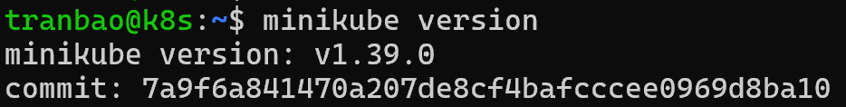
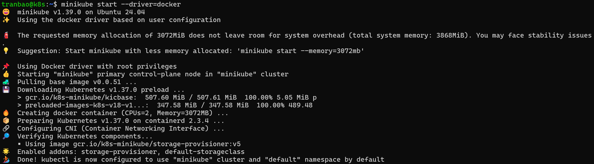
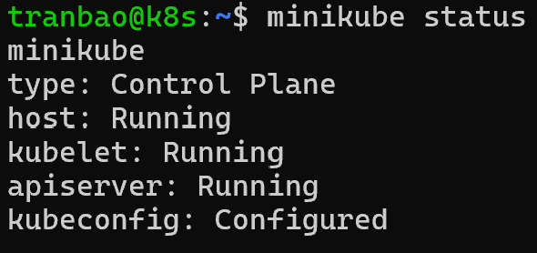
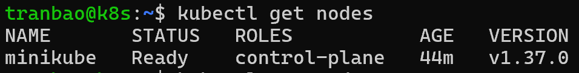
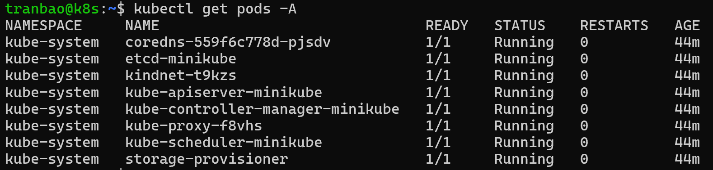

# Hướng dẫn cài đặt K8s bằng Minikube
## Mô tả
- Hướng dẫn cài đặt và chạy cụm Kubernetes trên 1 node bằng Minikube trên hệ điều hành Ubuntu Server 24.04
- Yêu cầu về phần cứng tối thiểu:
    + tối thiểu 2 vCPU
    + tối thiếu 2GB RAM (khuyến nghị 4GB trở lên)
    + Disk 20GB
    + Đã cài đặt Docker hoặc 1 hypervisor (VirtualBox, KVM/QEMU)

## Thực hành
- Bước 1: Cài đặt Docker (Container runtime cho Minikube)
``` bash
# Cập nhật repo và cài đặt Docker
sudo apt update
sudo apt install -y docker.io conntrack
# Khởi động dịch vụ Docker
sudo systemctl enable --now docker
# Thêm user hiện tại vào group docker để không cần gõ sudo khi sử dụng lệnh docker/minikube
sudo usermod -aG docker $USER
# Áp dụng quyền mới cho session hiện tại
newgrp docker
```

- Bước 2: Cài đặt Kubectl (Công cụ dòng lệnh K8s)
```bash
# Tải binary kubectl
curl -LO "https://dl.k8s.io/release/$(curl -L -s https://dl.k8s.io/release/stable.txt)/bin/linux/amd64/kubectl"
# Cấp quyền thực thi và đưa vào thư mục PATH
sudo install -o root -g root -m 0755 kubectl /usr/local/bin/kubectl
# Kiểm tra phiên bản đã cài
kubectl version --client
```

- Bước 3: Cài đặt Minikube
```bash
# Tải binary minikube
curl -LO https://storage.googleapis.com/minikube/releases/latest/minikube-linux-amd64
# Cài đặt vào /usr/local/bin/minikube
sudo install minikube-linux-amd64 /usr/local/bin/minikube
# Dọn dẹp file tải về
rm minikube-linux-amd64
# kiểm tra phiên bản đã cài
minikube version
```

- Bước 4: Khởi tạo cụm Kubernetes với Minikube
```bash
minikube start --driver=docker
```

- Bước 5: Kiểm tra trạng thái cụm Kubernetes
```bash
# Kiểm tra trạng thái Minikube
minikube status
# Kiểm tra node bằng kubectl
kubectl get nodes
# Kiểm tra các pod trên hệ thống
kubectl get pods -A
```



