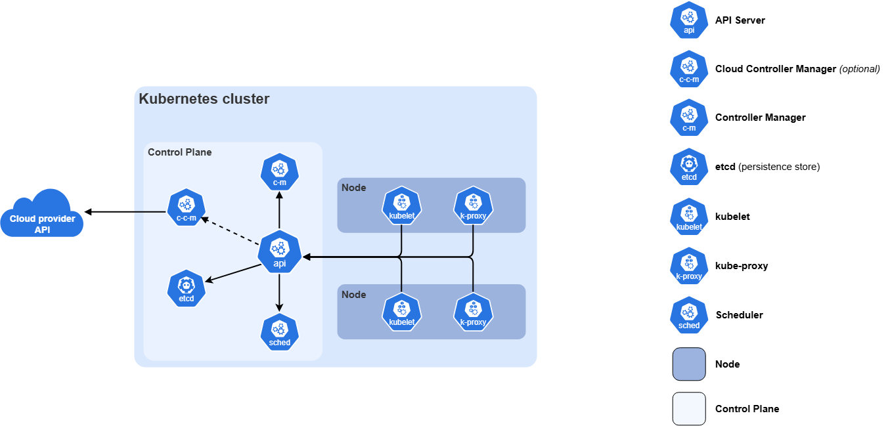
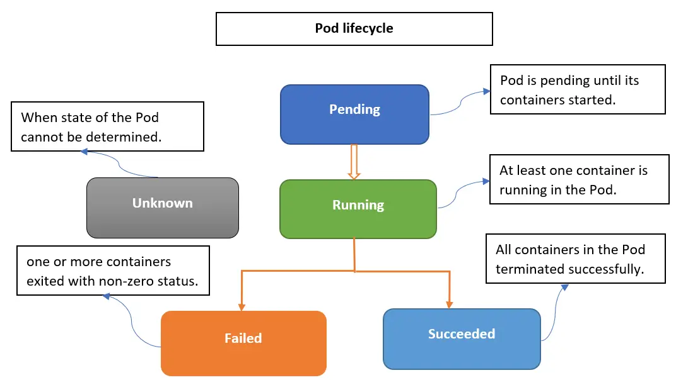

# TÌM HIỂU VỀ POD TRONG K8S
## Khái niệm
- Pod là đơn vị triển khai nhỏ nhất trong Kubernetes, đại diện cho một hoặc nhiều containers chạy cùng nhau trên một node. Các containers trong Pod chia sẻ network namespace (cùng IP và port), storage (qua volumes), và lifecycle. Pods là ephemeral nghĩa là chúng có thể bị destroy và recreate bất kỳ lúc nào, thường được quản lý bởi controllers như Deployments để đảm bảo availability.
- Một Pod cơ bản bao gồm:
    + *Metadata*: Tên, namespace, labels (để chọn lọc), annotations.
    + *Spec*: Mô tả containers (image, ports, resources), volumes, restart policy.
    + *Status*: Trạng thái hiện tại (Pending, Running, Succeeded, Failed, Unknown).
- Dưới đây là sơ đồ kiến trúc thành phần Kubernetes bao gồm Pods từ tài liệu chính thức, minh họa cách Pods nằm trong worker nodes và tương tác với control plane.


## Pod Lifecycle
- Trước khi quản lý Pods, bạn cần hiểu vòng đời của chúng để debug hiệu quả. Pod đi qua các giai đoạn sau:
    + *Pending*: Pod đã được tạo nhưng chưa được schedule lên node (ví dụ: chờ pull image hoặc thiếu resources).
    + *Running*: Ít nhất một container đang chạy bình thường.
    + *Succeeded*: Tất cả containers hoàn thành thành công (exit code 0), thường cho Jobs.
    + *Failed*: Ít nhất một container thất bại (exit code != 0).
    + *Unknown*: Không thể xác định trạng thái (lỗi network).
- Restart policy (Always, OnFailure, Never) quyết định hành vi khi container crash. Ví dụ: Policy “Always” sẽ restart container thất bại.
- Dưới đây là diagram vòng đời Pod từ tài liệu tham khảo, giúp bạn hình dung các trạng thái chuyển tiếp.


## Command Kubectl cơ bản để quản lý Pods
### Liệt kê và xem Pods
- Command cơ bản: kubectl get pods hoặc kubectl get po (tắt). Thêm `-n` nếu không ở default. 
    + Ví dụ: `kubectl get pods -o wide` (hiển thị IP, node).
    + Ví dụ nâng cao: `kubectl get pods -l app=frontend` (lọc bằng labels).
- Xem tất cả namespaces: `kubectl get pods --all-namespaces hoặc -A`
### Tạo Pod
**Imperative**
- Command: kubectl run <pod-name> --image=<image> [options].
    + Ví dụ: `kubectl run nginx-pod --image=nginx --port=80`
    + Options: `--restart=Never` (cho Pod standalone, không restart), `--dry-run=client -o yaml` (generate YAML mà không tạo thật).
**Declarative (YAML)**
- Viết file YAML rồi apply
    + Cấu trúc YAML cơ bản:
```bash
apiVersion: v1
kind: Pod
metadata:
  name: my-pod
  labels:
    app: myapp
spec:
  containers:
  - name: my-container
    image: nginx:latest
    ports:
    - containerPort: 80
  restartPolicy: Always
```
- Tạo: `kubectl apply -f my-pod.yaml` (tạo hoặc cập nhật).
- Hoặc `kubectl create -f my-pod.yaml` (chỉ tạo, lỗi nếu tồn tại).
### Mô tả Pod
- Command: `kubectl describe pod <pod-name>`
    + Hiển thị: Metadata, spec, status, conditions (Ready, Scheduled), events (lỗi pull image, crash).
    + Ví dụ: `kubectl describe pod nginx-pod` – Check nếu Pod Pending do thiếu resources.
### Xóa Pod
- Command: `kubectl delete pod <pod-name>` hoặc `kubectl delete -f my-pod.yaml`
    + Options: `--force --grace-period=0` (xóa ngay lập tức, không chờ terminate).
    + Xóa nhiều: `kubectl delete pods -l app=myapp`
- Pods bị xóa sẽ không recover trừ khi managed bởi Deployment (tự tạo mới).
### Các command khác
- Exec vào Pod: `kubectl exec -it <pod-name> -- /bin/sh` (mở shell, debug nội bộ).
- Xem Logs: `kubectl logs <pod-name> [-c <container>]` (xem output, thêm -f để follow realtime).
- Port Forward: `kubectl port-forward pod/<pod-name> 8080:80` (truy cập local).