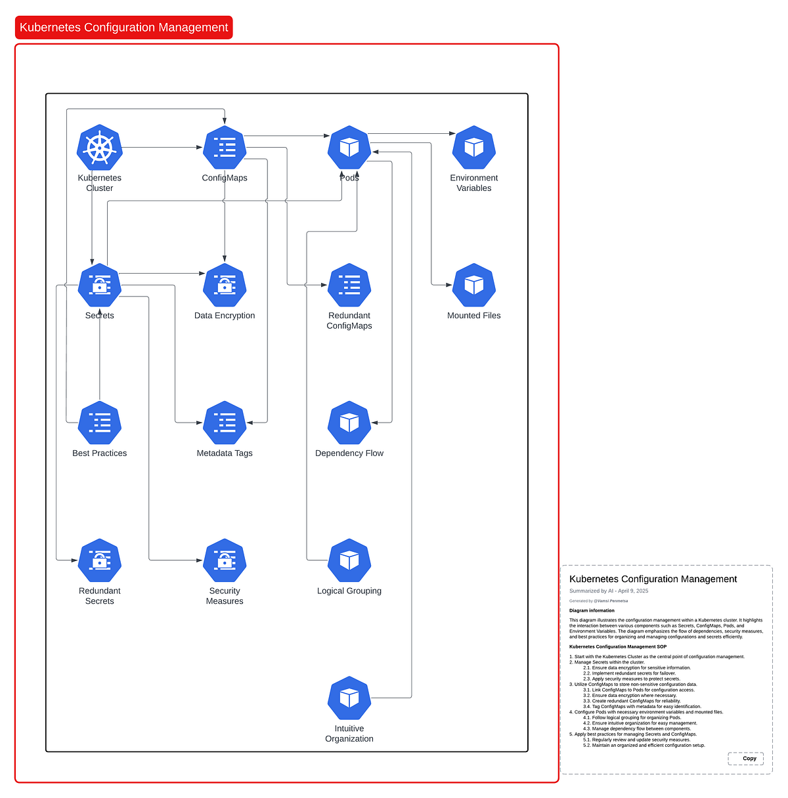
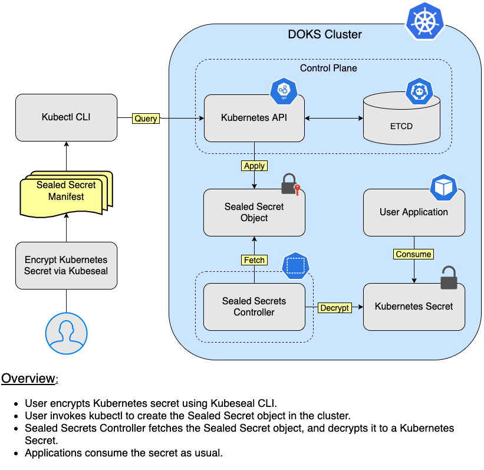

# TÌM HIỂU VỀ CONFIG MAP VÀ SECRET TRONG KUBERNETES
## ConfigMap là gì và tại sao nên sử dụng
- ConfigMap là một object Kubernetes dùng để lưu trữ dữ liệu cấu hình không nhạy cảm dưới dạng key-value pairs hoặc toàn bộ file. Nó giúp tách biệt config khỏi container image, cho phép bạn thay đổi hành vi ứng dụng mà không rebuild (ví dụ: thay đổi URL database hoặc log level). ConfigMap được lưu trong etcd như plain text, nên chỉ dùng cho dữ liệu không bí mật.
- Lợi ích chính:
    + *Decouple config*: Ứng dụng có thể đọc config từ env vars hoặc mounted files, dễ scale và update.
    + *Reusability*: Một ConfigMap có thể được sử dụng bởi nhiều Pods.
    + *Versioning*: Dễ quản lý qua Git, hỗ trợ CI/CD.
    + *Types*: Binary (cho file nhị phân) hoặc immutable (không thể chỉnh sửa sau tạo, để tránh lỗi).
- Dưới đây là sơ đồ minh họa cách ConfigMap được sử dụng trong Kubernetes:


## Secret là gì và sự khác biệt với ConfigMap
- Secret tương tự ConfigMap nhưng dành cho dữ liệu nhạy cảm như passwords, API keys, certificates. Dữ liệu trong Secret được mã hóa base64 (không phải encryption thực sự, chỉ obfuscation), và Kubernetes lưu chúng an toàn hơn (không expose qua kubectl get mặc định). Secret có thể là generic (từ literals/files), docker-registry (cho pull images), hoặc tls (cho certificates).
- Khác biệt chính với ConfigMap:
    + *Security*: Secret base64-encoded, không hiển thị plain text khi describe ConfigMap là plain text.
    + *Size limit*: Secret giới hạn 1MB (do etcd), ConfigMap cũng tương tự.
    + *Usage*: Secret cho sensitive data ConfigMap cho non-sensitive.
    + *Immutable*: Cả hai đều hỗ trợ, nhưng Secret thường dùng để tránh leak.
- Dưới đây là diagram về cách Secret hoạt động, minh họa luồng encrypt và consume trong cluster:


## So sánh ConfigMap và Secret

| Tiêu chí | ConfigMap | Secret |
|:---:|:---:|:---:|
| Dữ liệu | Non-sensitive (e.g., app settings, URLs) | Sensitive (e.g., passwords, keys) |
| Encoding | Plain text | Base64-encoded |
| Tạo từ | Literals, files, directories, env vars | Tương tự, plus dockerconfigjson, tls |
| Mount vào Pod | Env vars, volumes (subPath cho files) | Tương tự, nhưng cẩn thận với permissions |
| Immutable | Hỗ trợ (spec.immutable: true) | Hỗ trợ |
| Lệnh tạo imperative | kubectl create configmap | kubectl create secret generic |
| Xem dữ liệu | kubectl get cm -o yaml (plain) | kubectl get secret -o yaml (base64) |

## Cách tạo ConfigMap và Secret trong YAML
- Có hai cách: Imperative (nhanh cho test) và Declarative (YAML, ưu tiên cho CKAD).
### Tạo ConfigMap
**Imperative**
- Từ literals: `kubectl create configmap my-cm --from-literal=key1=value1 --from-literal=key2=value2`
- Từ file: `kubectl create configmap my-cm --from-file=config.properties`
- Từ env file: `kubectl create configmap my-cm --from-env-file=env.txt`
**Declarative (YAML)**
- Cấu trúc YAML:
```bash
apiVersion: v1
kind: ConfigMap
metadata:
  name: my-configmap
data:
  key1: value1
  config.properties: |  # Multi-line file
    property1=val1
    property2=val2
binaryData:  # Cho binary, base64-encoded
  binary-key: <base64-data>
immutable: true  # Optional
```
- Áp dụng: kubectl apply -f cm.yaml.
### Tạo Secret
**Imperative**
- Generic: `kubectl create secret generic my-secret --from-literal=password=supersecret --from-file=ssh-key=/path/to/key`
- TLS: `kubectl create secret tls my-tls --cert=path/to/cert --key=path/to/key`
- Docker registry: `kubectl create secret docker-registry my-reg --docker-server=... --docker-username=...`
**Declarative (YAML)**
- Cấu trúc YAML (data base64-encoded):
```bash
apiVersion: v1
kind: Secret
metadata:
  name: my-secret
type: Opaque  # Generic
data:
  password: c3VwZXJzZWNyZXQ=  # echo -n 'supersecret' | base64
  api-key: YXBpa2V5Cg==  
stringData:  # Plain text, Kubernetes sẽ encode
  username: admin
immutable: true
```
- Áp dụng: kubectl apply -f secret.yaml. Lưu ý: Sử dụng stringData để tránh encode thủ công.

## Mount ConfigMap/Secret vào Pod trong YAML
- Mount dưới dạng env vars (dễ đọc) hoặc volumes (cho files phức tạp).
**Mount Làm Environment Variables**
- YAML Pod ví dụ cho ConfigMap:
```bash
apiVersion: v1
kind: Pod
metadata:
  name: my-pod
spec:
  containers:
  - name: app
    image: busybox
    env:
    - name: KEY1
      valueFrom:
        configMapKeyRef:
          name: my-configmap
          key: key1
    - name: PASSWORD
      valueFrom:
        secretKeyRef:
          name: my-secret
          key: password
```
- Toàn bộ ConfigMap/Secret: envFrom: [configMapRef: {name: my-cm}] hoặc secretRef.

**Mount Làm Volumes**
- YAML Pod:
```bash
apiVersion: v1
kind: Pod
metadata:
  name: my-pod
spec:
  containers:
  - name: app
    image: nginx
    volumeMounts:
    - name: config-vol
      mountPath: /etc/config  # Đường dẫn trong container
      readOnly: true
    - name: secret-vol
      mountPath: /etc/secret
  volumes:
  - name: config-vol
    configMap:
      name: my-configmap
      items:  # Optional, chỉ mount key cụ thể
      - key: config.properties
        path: app.conf  # Tên file trong volume
  - name: secret-vol
    secret:
      secretName: my-secret
      items:
      - key: password
        path: db-pass.txt
        mode: 0400  # Permissions
```
- Dùng subPath để mount file cụ thể mà không overwrite thư mục.

## Các Lệnh Kubectl Để Quản Lý ConfigMap Và Secret
- *Get*: kubectl get configmap hoặc kubectl get secret.
Describe: kubectl describe cm my-cm (hiển thị data plain) kubectl describe secret my-secret (không hiển thị data).
- *Edit*: kubectl edit cm my-cm (mở editor sửa YAML).
- *Delete*: kubectl delete cm my-cm.
- *Xem data*: kubectl get cm my-cm -o yaml | grep data -A 10 cho Secret: kubectl get secret my-secret -o jsonpath='{.data.password}' | base64 -d.
