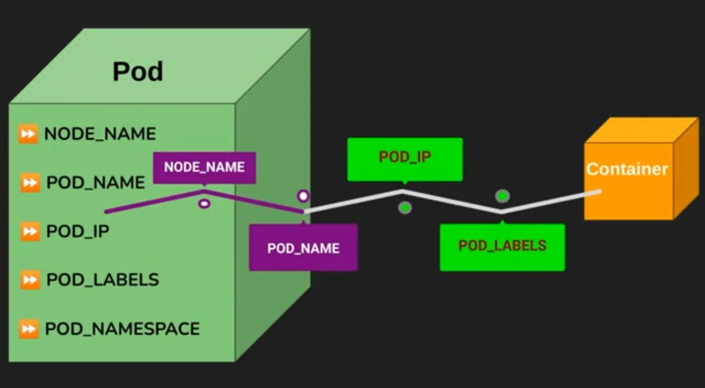

# TÌM HIỂU VỀ ENVIRONMENT VARIABLES
## Khái niệm
Environment variables là các biến hệ thống được inject vào process của container tại runtime, giúp truyền thông tin động như credentials, config values, hoặc metadata cluster mà không hardcode vào code ứng dụng. Trong Kubernetes, env vars được định nghĩa trong spec.containers[].env của Pod, và chúng override bất kỳ env vars nào trong container image.

Lợi ích chính:

Tách biệt config khỏi code: Dễ thay đổi mà không rebuild image (12-factor app principle).
Dynamic values: Sử dụng downward API để lấy metadata như Pod name, IP, hoặc node info.
Integration: Kết hợp với ConfigMap/Secret để inject data an toàn.
Portability: Ứng dụng có thể chạy ở nhiều môi trường (dev, prod) với env vars khác nhau.
Nguồn env vars trong Kubernetes:

Hardcoded values: Giá trị tĩnh trong YAML.
ConfigMap/Secret: Tham chiếu key từ objects này.
Downward API: Metadata từ Pod/fieldRef hoặc resourceFieldRef (ví dụ: CPU limits).
Container image: Env vars mặc định từ Dockerfile, nhưng có thể override.
Nếu có xung đột, env vars từ Pod spec ưu tiên cao nhất. Env vars là string, nhưng ứng dụng có thể parse chúng thành number/boolean.

Dưới đây là diagram minh họa cách env vars được inject vào Pod và containers, từ nguồn tham khảo, giúp bạn hình dung luồng dữ liệu:



## Command và Args

Command và args dùng để override entrypoint (command) và arguments (args) mặc định của container image. Trong Dockerfile, entrypoint là lệnh chính (ví dụ: /bin/app), args là tham số truyền vào (ví dụ: --port=80).

Trong Kubernetes:

Command: Mảng string thay thế ENTRYPOINT của image.
Args: Mảng string thay thế CMD của image.
Nếu không định nghĩa, dùng mặc định từ image.
Lợi ích:

Tùy chỉnh runtime: Chạy script cụ thể hoặc thay đổi behavior mà không rebuild.
Debug: Chạy shell thay vì app chính để troubleshoot.
Best practice: Sử dụng cho Jobs hoặc Pods one-off.
Ví dụ: Image có ENTRYPOINT [“/bin/echo”, “hello”], bạn có thể override command thành [“sleep”] và args thành [“infinity”] để giữ Pod chạy.

## Environment Variables Và Command/Args Trong YAML
### Environment Variables Trong YAML
- Cấu trúc cơ bản trong Pod spec:
```bash
apiVersion: v1
kind: Pod
metadata:
  name: env-pod
spec:
  containers:
  - name: my-container
    image: busybox
    env:  # Mảng các env var
    - name: STATIC_VAR  # Tên biến (uppercase convention)
      value: "hello world"  # Giá trị tĩnh
    - name: CONFIG_VAR
      valueFrom:
        configMapKeyRef:  # Từ ConfigMap
          name: my-configmap
          key: app.key
          optional: false  # Default false, error nếu không tồn tại
    - name: SECRET_VAR
      valueFrom:
        secretKeyRef:  # Từ Secret
          name: my-secret
          key: password
    - name: POD_NAME  # Downward API
      valueFrom:
        fieldRef:
          fieldPath: metadata.name  # Các field: metadata.name, status.podIP, spec.nodeName, etc.
    - name: CPU_LIMIT  # Resource field
      valueFrom:
        resourceFieldRef:
          containerName: my-container  # Optional
          resource: limits.cpu
    envFrom:  # Inject toàn bộ ConfigMap/Secret làm env vars (prefix optional)
    - configMapRef:
        name: my-configmap
    - secretRef:
        name: my-secret
        prefix: DB_  # Optional, prefix keys
```
- **Lưu ý**: envFrom inject tất cả keys làm env vars (key thành uppercase, thay – bằng _). Sử dụng cho nhiều vars.
### Command Và Args Trong YAML
- Trong container spec:
```bash
spec:
  containers:
  - name: my-container
    image: alpine
    command: ["/bin/sh"]  # Override ENTRYPOINT
    args: ["-c", "echo $MY_VAR && sleep 60"]  # Override CMD, có thể dùng env vars
```
- Command và args là mảng string để tránh shell parsing issues.

## #Bảng Tóm Tắt Các Nguồn Env Vars

| Nguồn | Mô tả | Ví dụ YAML | Ưu điểm |
|:---:|:---:|:---:|:---:|
| Value tĩnh | Giá trị hardcode trực tiếp | value: “value” | Đơn giản, nhanh |
| ConfigMapKeyRef | Tham chiếu key từ ConfigMap | configMapKeyRef: {name: cm, key: k} | Non-sensitive config, dễ update |
| SecretKeyRef | Tham chiếu key từ Secret | secretKeyRef: {name: sec, key: pass} | Sensitive data, base64-protected |
| FieldRef (Downward API) | Metadata từ Pod | fieldRef: {fieldPath: metadata.name} | Dynamic info như Pod IP, name |
| ResourceFieldRef | Resource requests/limits | resourceFieldRef: {resource: limits.cpu} | Tối ưu scaling dựa trên resources |
| EnvFrom | Inject toàn bộ từ ConfigMap/Secret | envFrom: [{configMapRef: {name: cm}}] | Bulk import, prefix để tránh conflict |

## Các Lệnh Kubectl Liên Quan
- *Tạo Pod với env vars (imperative)*: `kubectl run env-pod --image=busybox --env="KEY=value" --command -- sleep infinity`
- *Xem env vars trong Pod*: `kubectl exec env-pod -- env` (liệt kê tất cả env)
- *Describe Pod*: `kubectl describe pod env-pod` (xem env trong spec).
- *Edit Pod*: `kubectl edit pod env-pod` (sửa env, nhưng Pod immutable nên thường recreate).
- *Generate YAML*: `kubectl run --dry-run=client -o yaml --env="KEY=val" --command -- echo hello > pod.yaml`