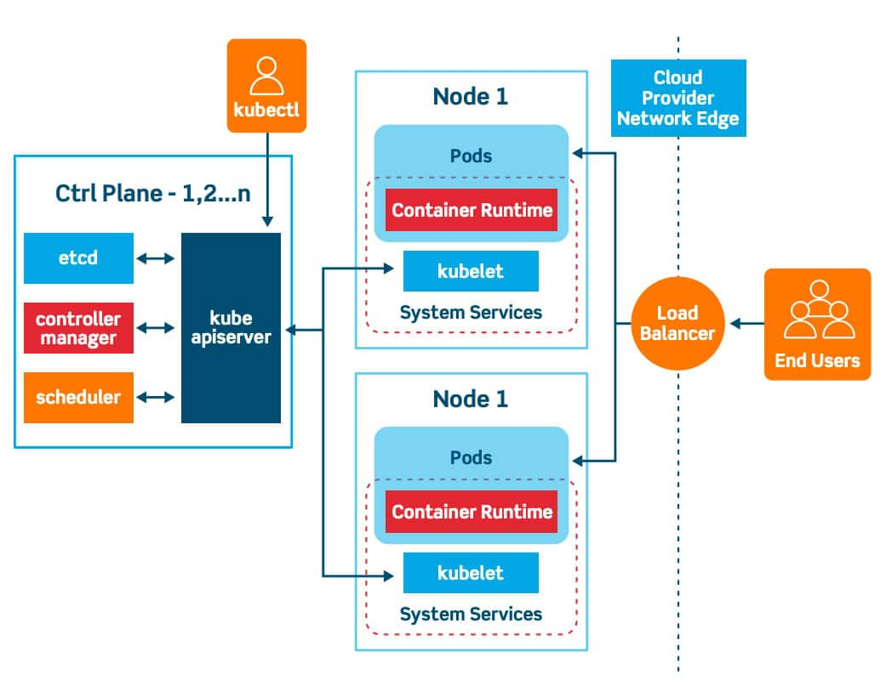
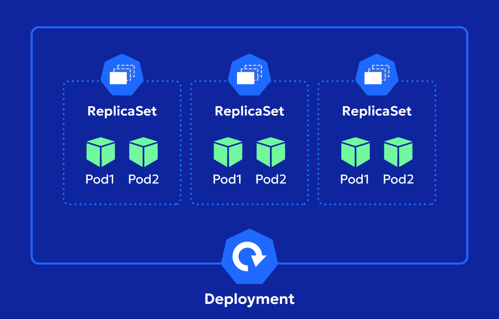
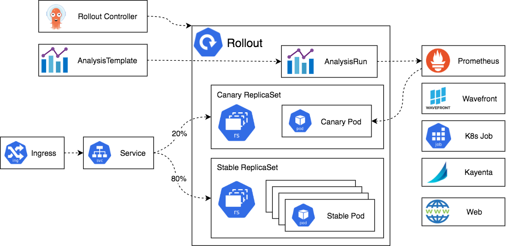

# TÌM HIỂU VỀ DEPLOYMENT VÀ REPLICASET
## Deployment
- Deployment là một controller Kubernetes quản lý việc triển khai và cập nhật Pods một cách declarative. Nó sử dụng ReplicaSet để duy trì số lượng Pods mong muốn, hỗ trợ rollout (cập nhật dần dần), rollback (quay lại phiên bản cũ), và scaling (tăng/giảm replicas). Deployment lý tưởng cho stateless apps như web servers, nơi Pods có thể thay thế mà không mất data.
- Lợi ích chính:
    + Zero-downtime updates: Cập nhật image hoặc config mà không gián đoạn service (rolling update strategy).
    + Version history: Tự động tạo ReplicaSet mới cho mỗi update, dễ rollback.
    + Scaling: Dễ dàng thay đổi số lượng Pods để handle traffic.
    + Self-healing: Tự động recreate Pods nếu crash hoặc node fail.
    + Pod template: Định nghĩa spec Pods (containers, volumes, env) trong Deployment.
- Deployment không quản lý trực tiếp Pods mà qua ReplicaSet – một layer abstraction để tránh chỉnh sửa thủ công. Trong sản xuất, Deployment là standard cho apps, kết hợp với Services cho exposure.
- Dưới đây là sơ đồ kiến trúc Deployment minh họa cách Deployment quản lý ReplicaSets và Pods:


## ReplicaSet
- ReplicaSet (RS) là controller duy trì số lượng Pods chính xác theo spec, sử dụng selector (labels) để match và manage Pods. Nếu Pods ít hơn replicas, RS tạo thêm nếu nhiều hơn, RS xóa bớt. RS là building block cho Deployment, nhưng hiếm khi dùng trực tiếp vì Deployment cung cấp thêm tính năng update/rollback.
- Khác biệt chính:
    + ReplicaSet: Chỉ duy trì replicas, không hỗ trợ update (nếu thay đổi template, phải tạo RS mới).
    + Deployment: Quản lý nhiều RS (mỗi update tạo RS mới), hỗ trợ strategy như RollingUpdate hoặc Recreate.
    + ReplicaSet kế thừa từ ReplicationController (cũ), nhưng hỗ trợ set-based selectors (matchExpressions) thay vì equality-based.
- Dưới đây là diagram minh họa ReplicaSet, cho thấy cách nó duy trì Pods qua labels:


## Bảng so sánh Deployment và ReplicaSet

| Tiêu chí | Deployment | ReplicaSet |
|:---:|:---:|:---:|
| Mục đích | Triển khai, update, rollback Pods | Duy trì số lượng Pods cố định |
| Quản lý | Quản lý nhiều RS, hỗ trợ history | Quản lý trực tiếp Pods qua selector |
| Update strategy | RollingUpdate (default), Recreate | Không hỗ trợ, phải xóa và tạo mới |
| Selector | Match labels/expressions | Tương tự |
| Sử dụng | Stateless apps, production | Internal cho Deployment, ít dùng trực tiếp |
| YAML kind | Deployment | ReplicaSet |
| Lệnh tạo imperative | kubectl create deployment | kubectl create rs |

## YAML File
### ReplicaSet
- Cấu trúc cơ bản:
```bash
apiVersion: apps/v1
kind: ReplicaSet
metadata:
  name: my-rs
  labels:
    app: myapp
spec:
  replicas: 3  # Số lượng Pods
  selector:
    matchLabels:  # Equality-based
      app: myapp
    matchExpressions:  # Set-based (optional)
    - key: tier
      operator: In
      values: [frontend]
  template:  # Pod template
    metadata:
      labels:
        app: myapp
    spec:
      containers:
      - name: nginx
        image: nginx:1.14
        ports:
        - containerPort: 80
```
- Áp dụng: `kubectl apply -f rs.yaml`
### Deployment
- Cấu trúc mở rộng từ RS:
```bash
apiVersion: apps/v1
kind: Deployment
metadata:
  name: my-deployment
spec:
  replicas: 3
  selector:
    matchLabels:
      app: myapp
  template:  # Giống RS
    metadata:
      labels:
        app: myapp
    spec:
      containers:
      - name: nginx
        image: nginx:1.14
  strategy:  # Update strategy
    type: RollingUpdate  # Hoặc Recreate (kill all then create)
    rollingUpdate:
      maxSurge: 25%  # Số Pods thêm tối đa (int hoặc %)
      maxUnavailable: 25%  # Số Pods unavailable tối đa
  minReadySeconds: 10  # Thời gian chờ Pod ready trước khi coi success
  revisionHistoryLimit: 10  # Giữ bao nhiêu RS cũ cho rollback
  paused: false  # Pause rollout (optional)

```
- Dưới đây là diagram quy trình rollout của Deployment, minh họa cách tạo RS mới và scale dần:


## Các Lệnh Kubectl Để Quản Lý Deployment Và ReplicaSet
- *Tạo Imperative*:
    + Deployment: `kubectl create deployment my-dep --image=nginx --replicas=3`
    + ReplicaSet: `kubectl create rs my-rs --image=nginx --replicas=3` (ít dùng).
- *Get/List*:
    + `kubectl get deployments hoặc kubectl get rs`
    + `kubectl get deployments -o wide` (xem replicas, image).
- *Describe*: `kubectl describe deployment my-dep` (xem events, conditions, RS liên quan).
- *Scale*:
    + `kubectl scale deployment my-dep --replicas=5`
    + Tương tự cho RS: `kubectl scale rs my-rs --replicas=5`
- *Update*:
    + `kubectl set image deployment/my-dep nginx=nginx:1.16` (trigger rollout).
    + Edit YAML: `kubectl edit deployment my-dep`
- *Rollout Management (chỉ Deployment)*:
    + Status: `kubectl rollout status deployment/my-dep`
    + History: `kubectl rollout history deployment/my-dep`
    + Rollback: `kubectl rollout undo deployment/my-dep --to-revision=2`
    + Pause/Resume: `kubectl rollout pause deployment/my-dep`, `kubectl rollout resume deployment/my-dep`
- *Delete*: `kubectl delete deployment my-dep` (xóa cascade RS và Pods).