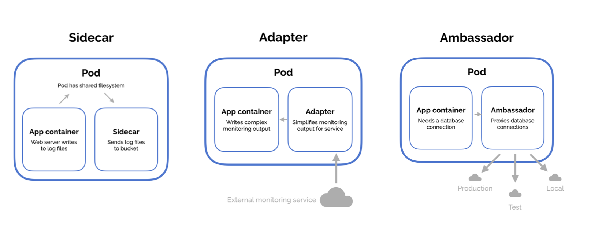
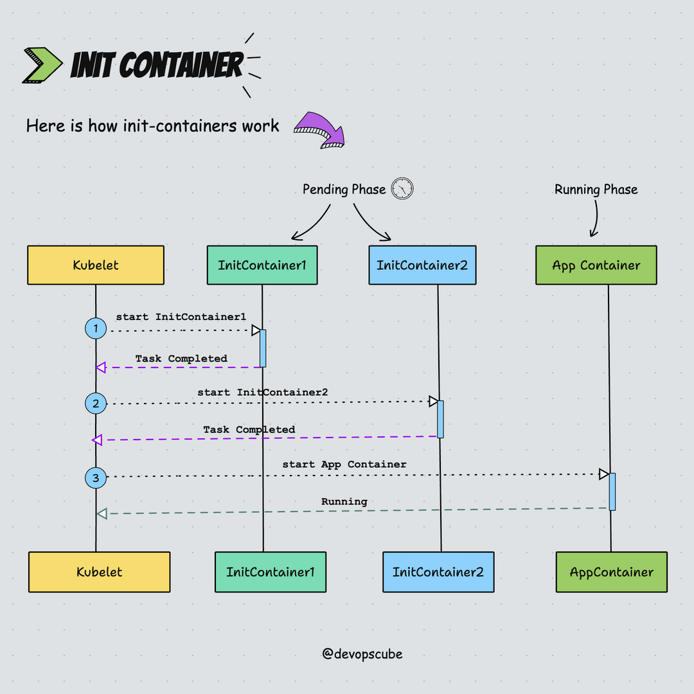
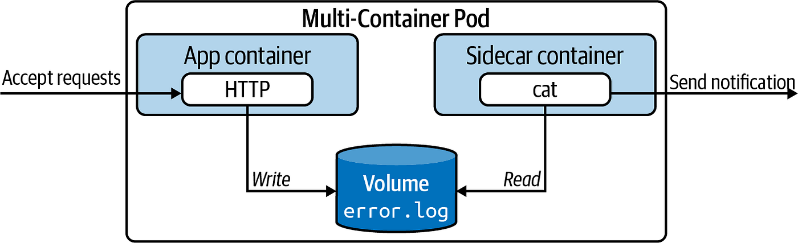
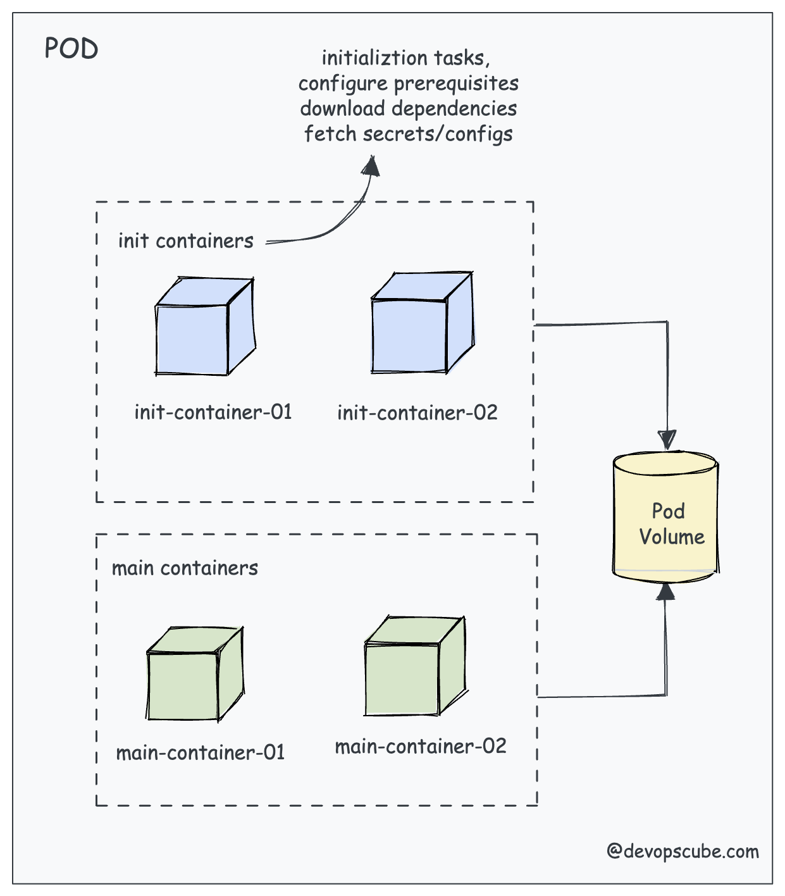
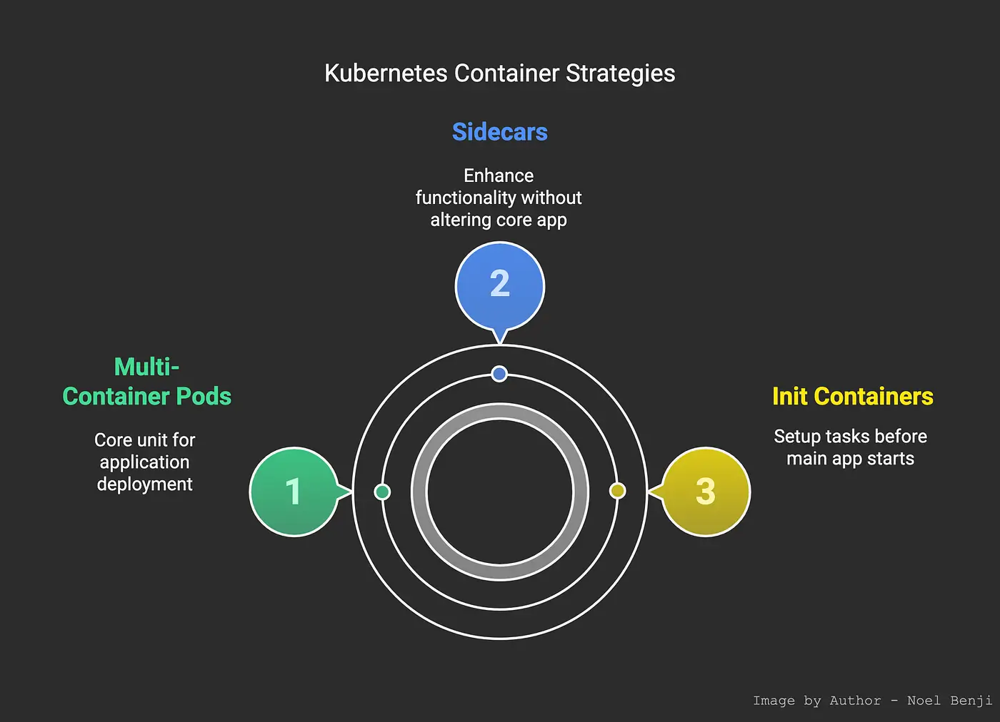

# TÌM HIỂU VỀ MULTI-CONTAINER PODS
## Lý do thiết kế Pod với nhiều container
- Mặc dù Pods thường có một container chính (app container), Kubernetes hỗ trợ nhiều containers trong cùng Pod để giải quyết các vấn đề phức tạp. Các containers chia sẻ:
    + *Network namespace*: Cùng IP và ports, giao tiếp qua localhost.
    + *Storage volumes*: Mount chung để chia sẻ files.
    + *IPC namespace*: Chia sẻ process signals nếu cần.
    + *Lifecycle*: Pod ready khi tất cả containers ready, nhưng init containers chạy trước.
- Lợi ích:
    + *Tight coupling*: Containers hỗ trợ lẫn nhau (ví dụ: logging sidecar thu thập logs từ app).
    + *Atomicity*: Đơn vị deploy nhỏ nhất, đảm bảo tất cả containers chạy cùng node.
    + *Efficiency*: Giảm overhead so với nhiều Pods riêng (mỗi Pod có overhead network/IP).
    + *Patterns*: Sidecar (enhance), Adapter (transform output), Ambassador (proxy external).
- Không nên dùng multi-container nếu containers không phụ thuộc chặt chẽ, vì khó scale độc lập. Trong CKAD, tập trung vào việc viết YAML đúng để tránh lỗi như containers không chia sẻ volume.
- Dưới đây là sơ đồ kiến trúc multi-container Pod minh họa cách các containers chia sẻ tài nguyên trong Pod:


## Design Patterns phổ biến trong Multi-Container Pods
- Kubernetes khuyến nghị ba patterns chính: Sidecar, Ambassador, và Adapter. Ngoài ra, Init Containers là loại đặc biệt chạy trước app containers.

### Init Containers
- Init containers chạy sequentially trước app containers, dùng để setup môi trường (ví dụ: clone repo, check database ready, generate config). Chúng chạy đến hoàn thành (exit 0), nếu fail thì retry theo restartPolicy (default Always cho init).
- Đặc điểm:
    + Chạy trước, không chạy parallel với app.
    + Không support readiness/liveness probes (vì one-time).
    + Chia sẻ volumes với app containers.
    + Dùng cho tasks không thuộc app chính, tránh bloat image.
- Ví dụ: Init container clone Git repo vào volume, rồi app container dùng code đó.
- Dưới đây là diagram lifecycle init containers của devopscube cũng đã thể hiện khá rõ ràng cho thấy thứ tự chạy và chuyển sang app phase:

### Sidecar Pattern
- Sidecar là container phụ chạy parallel với app, enhance functionality (ví dụ: logging, monitoring, encryption). Sidecar không thay thế app mà hỗ trợ nó.
- Ví dụ: App container write logs vào file, sidecar đọc và ship đến ELK stack.
### Ambassador Pattern
- Ambassador là proxy cho app container kết nối external services (ví dụ: database sharding, A/B testing). App connect localhost, ambassador handle logic.
- Ví dụ: App connect DB qua ambassador, nó route đến prod/dev dựa trên env.
### Adapter Pattern
- Adapter transform output của app để match chuẩn (ví dụ: convert logs sang JSON cho monitoring tool).
- Dưới đây là ví dụ patterns sidecar, adapter, ambassador trong multi-container Pod:


## Tóm tắt các Patterns
| Pattern | Mô tả | Ví dụ | Ưu điểm |
|:---:|:---:|:---:|:---:|
| Init Container | Chạy trước app để setup | Clone repo, wait for service ready | Đảm bảo precondition, không block app |
| Sidecar | Hỗ trợ app parallel | Logging agent, file sync | Enhance mà không modify app code |
| Ambassador | Proxy external connections | DB proxy, service mesh sidecar | Abstract networking complexity |
| Adapter | Transform app output | Metrics exporter, log formatter | Standardize output cho integration |

## YAML File
### Init và Sidecar
```bash
apiVersion: v1
kind: Pod
metadata:
  name: multi-pod
spec:
  initContainers:
  - name: init-setup
    image: busybox
    command: ['sh', '-c', 'echo "Setup done" > /work-dir/setup.txt']
    volumeMounts:
    - name: shared-vol
      mountPath: /work-dir
  containers:
  - name: app-container
    image: nginx
    ports:
    - containerPort: 80
    volumeMounts:
    - name: shared-vol
      mountPath: /usr/share/nginx/html
  - name: sidecar-logger
    image: busybox
    command: ['sh', '-c', 'tail -f /var/log/nginx/access.log']
    volumeMounts:
    - name: log-vol
      mountPath: /var/log/nginx
  volumes:
  - name: shared-vol
    emptyDir: {}
  - name: log-vol
    emptyDir: {}
```
- Lưu ý: Init chạy trước, containers chạy parallel. Sử dụng volumes để share data.

## Các Lệnh Kubectl Để Quản Lý Multi-Container Pods
- *Tạo Pod*: kubectl apply -f multi-pod.yaml.
- *Get Pods*: kubectl get pods (xem status multi-containers).
- *Describe*: kubectl describe pod multi-pod (xem events mỗi container, init status).
- *Logs*: kubectl logs multi-pod -c sidecar-logger (chỉ định container).
- *Exec*: kubectl exec -it multi-pod -c app-container -- /bin/sh.
- *Debug Init Fail*: Nếu init crash, Pod ở Init phase, dùng describe xem logs init.

## Sidecar Container
### Khái niệm
- Sidecar là một container phụ chạy song song với container chính (app container) trong cùng Pod, nhằm mở rộng hoặc hỗ trợ chức năng mà không thay đổi code của app chính. Sidecar thường xử lý các nhiệm vụ phụ như logging, monitoring, proxy, hoặc file synchronization. Vì chia sẻ network và storage với app, sidecar có thể giao tiếp qua localhost hoặc read/write files chung mà không cần overhead network.
- Lợi ích chính của sidecar:
    + *Non-invasive enhancement*: Thêm tính năng như encrypt traffic hoặc ship logs mà không modify app image.
    + *Modularity*: Tách biệt trách nhiệm, dễ maintain (ví dụ: update logging tool riêng).
    + *Common use cases*: Logging (Fluentd sidecar thu thập logs từ app), Proxy (Envoy sidecar cho service mesh), Monitoring (Prometheus exporter), hoặc Backup (sidecar sync files đến storage external).
    + *Limitations*: Tăng resource usage cho Pod, không scale độc lập (toàn Pod scale cùng).
- Ví dụ điển hình: Một web app (nginx) write logs vào volume, sidecar (busybox hoặc fluentbit) đọc logs và gửi đến central log server như Elasticsearch.
- Dưới đây là diagram minh họa pattern sidecar trong Kubernetes, cho thấy cách sidecar hỗ trợ app container qua shared volume:

### Cấu hình trong YAML
- Sidecar được định nghĩa trong mảng spec.containers, cùng với app container. Sử dụng volumes để share data.
- YAML ví dụ cho sidecar logging:
```bash
apiVersion: v1
kind: Pod
metadata:
  name: sidecar-pod
spec:
  containers:
  - name: app-container
    image: nginx:latest
    volumeMounts:
    - name: logs-volume
      mountPath: /var/log/nginx
  - name: logging-sidecar
    image: busybox
    command: ["/bin/sh"]
    args: ["-c", "tail -n+1 -f /var/log/nginx/access.log"]
    volumeMounts:
    - name: logs-volume
      mountPath: /var/log/nginx
  volumes:
  - name: logs-volume
    emptyDir: {}
```
- Trong ví dụ này, app write logs vào /var/log/nginx, sidecar đọc và output (có thể thay bằng fluentd để ship real).
- Dưới đây là ví dụ cụ thể về multi-container Pod với sidecar, minh họa luồng write-read logs:


## Init container
### Khái niệm
- Init Container là container đặc biệt chạy trước app containers trong Pod, dùng để thực hiện các nhiệm vụ khởi tạo như download dependencies, generate config, hoặc wait until a service is ready. Chúng chạy sequentially (một sau một), phải hoàn thành (exit 0) trước khi app start. Nếu init fail, Kubernetes retry theo restartPolicy (default Always).
- Lợi ích chính:
    + *Setup precondition*: Đảm bảo môi trường sẵn sàng (ví dụ: clone Git repo vào volume, check DB connection).
    + *Security*: Chạy với privileges cao hơn app (ví dụ: chown files), rồi app chạy least privilege.
    + *One-time tasks*: Không chạy liên tục như sidecar, tiết kiệm resource.
    + *Common use cases*: Wait for service (curl loop đến khi ready), Populate volume (wget files), hoặc Register Pod với external system.
- Ví dụ: Init container download HTML file vào volume, rồi nginx app serve nó.
- Dưới đây là diagram lifecycle của init containers bài trước bạn cũng đã thấy rồi, minh họa thứ tự chạy và chuyển tiếp đến app phase:


### Cấu hình trong YAML
- Init containers định nghĩa trong spec.initContainers, chạy trước containers.
- YAML ví dụ cho init setup:
```bash
apiVersion: v1
kind: Pod
metadata:
  name: init-pod
spec:
  initContainers:
  - name: init-downloader
    image: busybox
    command: ["/bin/sh"]
    args: ["-c", "wget -O /work-dir/index.html http://example.com/index.html"]
    volumeMounts:
    - name: work-volume
      mountPath: /work-dir
  containers:
  - name: app-container
    image: nginx
    volumeMounts:
    - name: work-volume
      mountPath: /usr/share/nginx/html
  volumes:
  - name: work-volume
    emptyDir: {}
```
- Init download file, rồi app serve nó.
- Dưới đây là diagram Pod với init containers, cho thấy cách init populate volume cho main containers:


## So sánh Sidecar và Init container
| Tiêu chí | Sidecar Container | Init Container |
|:---:|:---:|:---:|
| Vị trí trong YAML | spec.containers (cùng app) | spec.initContainers (riêng) |
| Thời gian chạy | Song song và liên tục với app | Trước app, one-time đến hoàn thành |
| Mục đích | Hỗ trợ/enhance app (logging, proxy) | Khởi tạo/setup (download, wait) |
| Restart policy | Theo Pod (Always/OnFailure/Never) | Default Always nếu fail |
| Probes | Hỗ trợ liveness/readiness | Không hỗ trợ (vì one-time) |
| Resource usage | Chạy lâu dài, chia sẻ resource | Ngắn hạn, release sau hoàn thành |
| Use case ví dụ | Ship logs đến external | Clone repo vào volume |

## Kết hợp Sidecar và Init container trong cùng 1 Pod
- Bạn có thể dùng cả hai trong cùng Pod: Init setup ban đầu, rồi app + sidecar chạy.
- YAML kết hợp:
```bash
apiVersion: v1
kind: Pod
metadata:
  name: combined-pod
spec:
  initContainers:
  - name: init-setup
    image: busybox
    command: ['sh', '-c', 'echo "Init done" > /data/init.txt']
    volumeMounts:
    - name: shared-data
      mountPath: /data
  containers:
  - name: app
    image: nginx
    volumeMounts:
    - name: shared-data
      mountPath: /usr/share/nginx/html
  - name: sidecar
    image: busybox
    command: ['sh', '-c', 'while true; do echo "Sidecar running" >> /data/log.txt; sleep 5; done']
    volumeMounts:
    - name: shared-data
      mountPath: /data
  volumes:
  - name: shared-data
    emptyDir: {}
```
- Dưới đây là diagram tổng quan về container strategies bao gồm sidecar và init.


## Các Lệnh Kubectl Để Quản Lý Sidecar Và Init Container
- *Logs cụ thể*: kubectl logs combined-pod -c sidecar (lấy logs sidecar/init).
- *Exec vào container*: kubectl exec -it combined-pod -c app -- /bin/bash.
- *Describe Pod*: kubectl describe pod combined-pod (xem status mỗi container, events init).
- *Debug init fail*: Nếu Pod stuck ở Init:0/1, dùng logs -c init-setup xem lỗi.
- *Get all containers*: kubectl get pod combined-pod -o jsonpath='{.spec.containers[*].name} {.spec.initContainers[*].name}'.