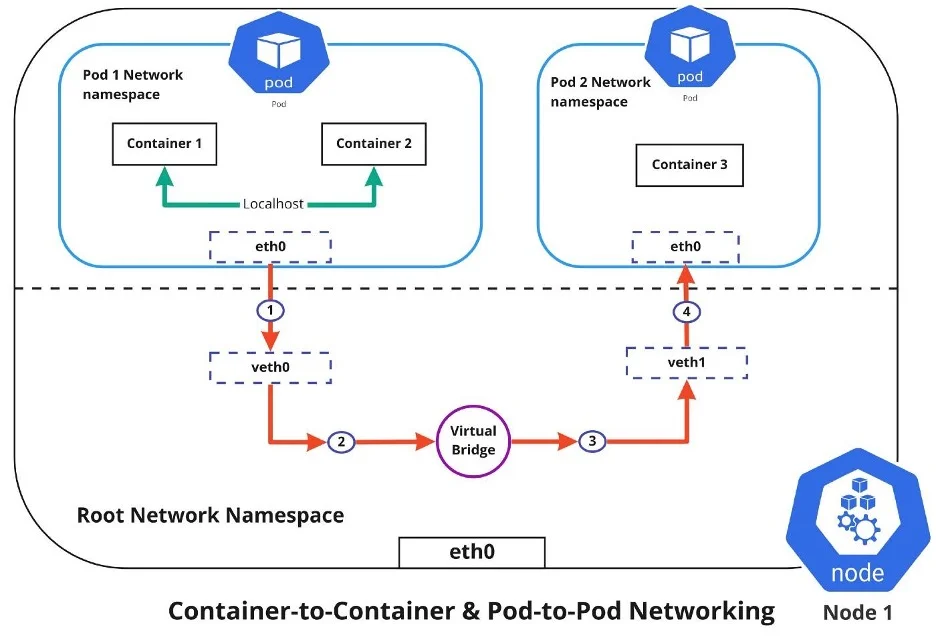

# TÌM HIỂU VỀ CHIA SẺ TÀI NGUYÊN GIỮA CÁC CONTAINER
## Tại sao lại chia sẻ tài nguyên
- Trong một Pod multi-container, các containers được thiết kế để hoạt động như một đơn vị cohesive, tương tự các process trong cùng máy ảo. Kubernetes tận dụng Linux namespaces và cgroups để isolate containers, nhưng cho phép chia sẻ một số namespaces để hỗ trợ interaction.
- Điều này giúp:
    + *Giảm latency*: Giao tiếp qua localhost thay vì network full (ví dụ: app gửi request đến sidecar proxy trên port 8080).
    + *Chia sẻ data*: Sử dụng volumes để read/write files chung, tránh duplicate storage hoặc external mounts.
    + *Tích hợp chặt chẽ*: Sidecar có thể monitor app qua shared process signals (IPC) hoặc PID namespace.
    + *Efficiency*: Giảm resource overhead so với multi-Pods (mỗi Pod có IP riêng, network policies phức tạp hơn).
    + *Patterns hỗ trợ*: Enable sidecar (share logs qua volume), ambassador (share network cho proxy), adapter (transform data chung).
- Tuy nhiên, chia sẻ cũng có rủi ro: Một container crash có thể ảnh hưởng toàn Pod, hoặc conflict permissions trên shared volume. Trong CKAD, hiểu phần này giúp bạn debug nhanh, ví dụ: Tại sao sidecar không thấy file từ app? (Sai mountPath hoặc volume type).

## Các loại tài nguyên có thể chia sẻ
- Kubernetes cho phép chia sẻ nhiều loại namespaces và resources. Dưới đây là các loại chính, với giải thích và ví dụ.
### Network Namespace
- Tất cả containers trong Pod chia sẻ cùng network namespace: Cùng IP, ports, và localhost. Điều này cho phép:
    + Giao tiếp nội bộ qua localhost:port mà không cần Service hoặc DNS.
    + Sidecar proxy traffic: App connect localhost:8080, sidecar forward đến external.
    + Debug: Exec vào một container để curl localhost từ container khác.
- Ví dụ: App container listen port 80, sidecar curl localhost:80 để health check.
- Dưới đây là diagram network namespace sharing trong Pod, minh họa cách containers dùng cùng eth0 interface:

### Storage (Volumes)
- Chia sẻ storage qua volumes là phổ biến nhất, cho phép containers mount cùng volume để read/write files. Types volumes cho sharing:
    + emptyDir: Temporary, xóa khi Pod die; lý tưởng cho cache/logs.
    + hostPath: Mount từ node host, share giữa containers nhưng không persistent qua Pod restarts.
    + configMap/Secret: Mount config như files, share env-like data.
    + persistentVolume: Cho data persistent, nhưng trong multi-container thường dùng emptyDir cho intra-Pod.
- Ví dụ: App write logs vào /var/log/app.log trên volume, sidecar đọc và ship.
- Dưới đây là diagram shared volume giữa containers trong Pod, cho thấy read/write flow:

### IPC Namespace
- IPC (Inter-Process Communication) namespace cho phép chia sẻ message queues, semaphores, shared memory. Default không share, nhưng enable bằng spec.`shareProcessNamespace: true` (chia PID namespace nữa).
    + Use case: Containers cần signal nhau (kill process), hoặc share memory cho performance (rare in containers).
    + Rủi ro: Security issues nếu không trust containers.
### PID Namespace (Với ShareProcessNamespace)
- Khi enable `shareProcessNamespace: true`, containers thấy processes của nhau qua /proc, có thể ps aux từ một container thấy tất cả.

    + Use case: Debug toàn Pod, hoặc sidecar monitor app processes.
    + Ví dụ: Sidecar dùng kill để signal app container.
### UTS Namespace
- Containers chia sẻ hostname và domainname (UTS namespace), nên hostname giống nhau.
### Environment Variables và Config
- Không trực tiếp share env vars, nhưng có thể dùng Downward API hoặc ConfigMap để inject chung.
### Bảng tóm tắt
| Tài Nguyên | Cách Chia Sẻ | Ví Dụ Use Case | YAML Config |
|:---:|:---:|:---:|:---:|
| Network Namespace | Default chia sẻ | App-sidecar giao tiếp localhost:port | Không cần, auto |
| Storage Volumes | Mount cùng volume vào volumeMounts | Share logs/files giữa app và sidecar | spec.volumes & volumeMounts |
| IPC Namespace | Default isolate, enable shareProcessNamespace | Share message queues | spec.shareProcessNamespace: true |
| PID Namespace | Enable shareProcessNamespace | Monitor processes từ sidecar | spec.shareProcessNamespace: true |
| UTS Namespace | Default chia sẻ | Chung hostname | Auto |
| Env Vars | Không direct, dùng ConfigMap chung | Inject config cho tất cả containers | envFrom: configMapRef |

## Cấu hình chia sẻ tài nguyên trong YAML
### Chia sẻ Volume (Storage)
- Pod với app và sidecar share emptyDir cho logs:
```bash
apiVersion: v1
kind: Pod
metadata:
  name: shared-volume-pod
spec:
  containers:
  - name: app-container
    image: nginx
    volumeMounts:
    - name: shared-logs
      mountPath: /var/log/app
  - name: sidecar-container
    image: busybox
    command: ["/bin/sh"]
    args: ["-c", "tail -f /logs/access.log"]
    volumeMounts:
    - name: shared-logs
      mountPath: /logs
  volumes:
  - name: shared-logs
    emptyDir: {}
```
- App write vào /var/log/app, sidecar đọc từ /logs.
### Chia sẻ Network (Localhost)
- App listen 80, sidecar curl localhost:
```bash
apiVersion: v1
kind: Pod
metadata:
  name: shared-network-pod
spec:
  containers:
  - name: app-container
    image: nginx
    ports:
    - containerPort: 80
  - name: client-sidecar
    image: busybox
    command: ["/bin/sh"]
    args: ["-c", "while true; do wget -q -O- localhost:80; sleep 10; done"]
```
- Sidecar access app qua localhost:80.
### Chia sẻ Process Namespace
- Enable `shareProcessNamespace` để sidecar thấy processes của app:
```bash
apiVersion: v1
kind: Pod
metadata:
  name: shared-process-pod
spec:
  shareProcessNamespace: true
  containers:
  - name: app-container
    image: nginx
  - name: monitor-sidecar
    image: busybox
    command: ["/bin/sh"]
    args: ["-c", "ps aux; sleep infinity"]
```
- Sidecar chạy ps aux thấy nginx processes.

## Các lệnh Kubectl để quản lý và debug chia sẻ
- *Describe Pod*: `kubectl describe pod shared-volume-pod` (xem volumeMounts, events nếu mount fail).
- *Exec để check share*: `kubectl exec -it shared-volume-pod -c sidecar-container -- ls /logs` (xem files từ app).
- *Logs từ sidecar*: `kubectl logs shared-volume-pod -c sidecar-container`
- *Check network*: `kubectl exec -it shared-network-pod -c client-sidecar -- curl localhost:80`
- *Debug process*: `kubectl exec -it shared-process-pod -c monitor-sidecar -- ps aux` (thấy all processes).
- *Port-forward để test*: `kubectl port-forward pod/shared-network-pod 8080:80` (access app từ local).
