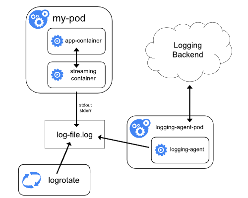
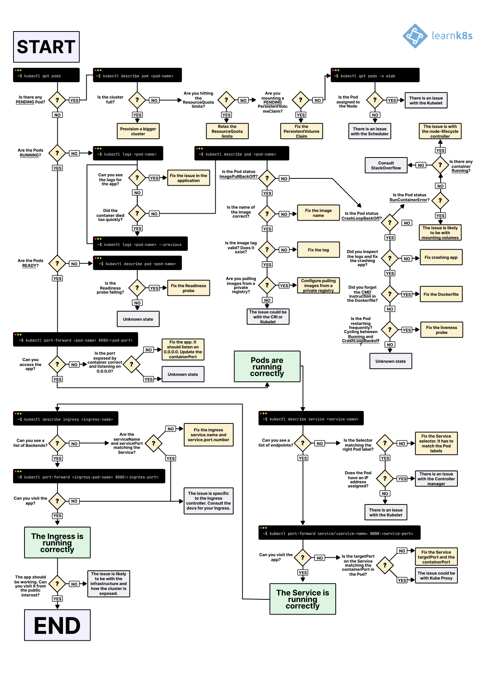
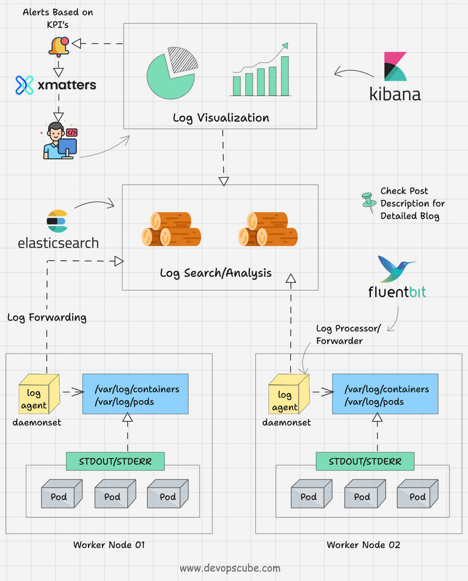

# TÌM HIỂU VỀ LOGS VÀ EVENTS TRONG K8S
## Logs
- Logs là output từ stdout/stderr của containers, bao gồm messages ứng dụng, errors, hoặc debug info. Kubernetes không lưu logs persistent (trừ khi config), mà forward chúng từ container runtime (như containerd) đến kubelet, rồi có thể aggregate qua sidecar hoặc daemon như Fluentd.
- Cấu trúc logs:
    + Container logs: Lưu tại /var/log/containers trên node, symlink đến /var/log/pods.
    + Pod logs: Aggregate từ tất cả containers trong Pod.
    + Cluster logs: Bao gồm kubelet, API server logs, nhưng focus CKAD là Pod/container logs.
- Cách quản lý logs:
    + Basic: kubectl logs lấy trực tiếp từ kubelet.
    + Advanced: Sidecar container ship logs đến ELK (Elasticsearch, Logstash, Kibana) hoặc tools như Loki.
    + Best practice: Không write logs vào files trong container (trừ volume), dùng stdout để dễ aggregate.
- Dưới đây là diagram kiến trúc logging từ tài liệu chính thức Kubernetes, minh họa cách logs từ container streaming đến backend qua sidecar:

## Events
- Events là objects ghi lại các sự kiện xảy ra trong cluster, như Pod created, scheduled, image pull fail, hoặc node not ready. Chúng lưu trong etcd với TTL (default 1 giờ), giúp trace vấn đề hệ thống.
- Types events:
    + Normal: Thông tin thông thường (e.g., Pulling image).
    + Warning: Lỗi tiềm ẩn (e.g., FailedScheduling).
- Events liên kết với objects (Pod, Node) qua involvedObject field.
Dưới đây là ví dụ output `kubectl get events`:

## Các lệnh Kubectl để giám sát Logs
- `kubectl logs` lấy logs từ Pod/container. Syntax cơ bản: `kubectl logs <pod-name> [-c <container>] [options]`
### Lệnh Cơ Bản Và Options
- *Lấy logs Pod đơn container*: `kubectl logs my-pod`
- *Chỉ định container*: `kubectl logs my-pod -c sidecar` (bắt buộc cho multi-container).
- *Follow realtime*: `kubectl logs -f my-pod` (tail logs như tail -f).
- *Logs từ previous container*: `kubectl logs my-pod --previous` (nếu container crash và restart).
- *Limit lines*: `kubectl logs my-pod --tail=50` (last 50 lines).
- *Timestamp*: `kubectl logs my-pod --timestamps` (thêm time prefix).
- *Since time*: `kubectl logs my-pod --since=1h` hoặc --since-time=2023-10-24T00:00:00Z.
- *All containers*: `kubectl logs my-pod --all-containers` (aggregate từ tất cả).
- Ví dụ: Debug CrashLoopBackOff: `kubectl logs my-pod --previous -c app`
### Các Lệnh Kubectl Để Giám Sát Events
- *Liệt kê events*: `kubectl get events` (default namespace).
- *All namespaces*: `kubectl get events -A`
- *Watch realtime*: `kubectl get events --watch`
- *Sort by time*: `kubectl get events --sort-by=.metadata.creationTimestamp`
- *Output format*: `kubectl get events -o wide` (thêm details).
- *Filter*: Dùng `kubectl get events -l app=myapp` (label selector).
- Ví dụ: Debug Pod fail: `kubectl get events --sort-by=.metadata.creationTimestamp | grep my-pod`
- Dưới đây là flowchart troubleshooting Kubernetes với logs và events, hữu ích cho debug flow.

- Diagram pod logs và events flow, minh họa cách events liên kết với logs cho observability:

## Bảng cheat sheet lệnh Logs và Events
| Lệnh | Mô tả | Ví dụ |
|:---:|:---:|:---:|
| kubectl logs [pod] | Lấy logs Pod cơ bản | kubectl logs nginx-pod |
| kubectl logs -f pod -c [cont] | Follow logs container cụ thể | kubectl logs -f nginx-pod -c nginx |
| kubectl logs –previous [pod] | Logs từ instance trước (crash) | kubectl logs –previous crashed-pod |
| kubectl logs –tail=100 [pod] | Last 100 lines | kubectl logs –tail=100 busybox |
| kubectl get events -A | Liệt kê events all namespaces | kubectl get events -A |
| kubectl get events –watch | Watch events realtime | kubectl get events –watch |
| kubectl get events -o yaml | Output YAML chi tiết | kubectl get events -o yaml |

## kube describe
- `kubectl describe` là lệnh cung cấp thông tin chi tiết về một resource (như Pod, Node, Deployment), bao gồm metadata, spec, status, conditions, và events liên quan. Đây là “first stop” cho debug, vì nó aggregate data từ API server mà không cần nhiều lệnh riêng lẻ.
- Cấu trúc output của describe pod:
    + *Name/Namespace/Labels/Annotations*: Metadata cơ bản.
    + *Status*: Phase (Pending/Running/Succeeded/Failed/Unknown), Conditions (Ready, Initialized, etc.), IP/Node.
    + *Containers/Init Containers*: Image, State (Running/Waiting/Terminated), Ready, Restart Count, Probes.
    + *Volumes/Mounts*: Chi tiết storage.
    + *Events*: Last events liên quan đến Pod (rất hữu ích cho debug).
- Use cases debug:
    + *Pod Pending*: Check events cho FailedScheduling hoặc Insufficient resources.
    + *CrashLoopBackOff*: Xem Restart Count cao, Last State Terminated với exit code/reason.
    + *Not Ready*: Check Conditions False (e.g., ContainersReady False).
    + *Syntax*: kubectl describe pod [-n ].
- Options:
    + `--show-events=false`: Ẩn events nếu không cần.
    + Output chỉ phần: Kết hợp với | `grep Events` để filter.

## kube exec
- `kubectl exec` cho phép chạy lệnh bên trong container của Pod, tương tự SSH vào máy ảo. Đây là công cụ interactive để check files, processes, env vars, hoặc test network từ góc nhìn container.
- Syntax: `kubectl exec [-c ] [-n ] [-it] --`
- Options:
    + `-i`: Interactive (stdin).
    + `-t`: TTY (pseudo-terminal cho shell).
    + `-c`: Chỉ định container (default đầu tiên).
Ví dụ shell: kubectl exec -it my-pod -- /bin/sh (mở shell).
- Use cases debug:
    + Check files: ls /app, cat /etc/config.
    + Processes: ps aux, top.
    + Network: curl localhost:80, ping google.com.
    + Env: env | grep DB.
- Lưu ý: Exec yêu cầu container running; nếu crash, dùng ephemeral debug container (nâng cao, không trong CKAD cơ bản).

## Kết hợp kube describe và exec với công cụ khác để debug
- Debug hiệu quả thường kết hợp:
    + `get pods`: Xem overview status.
    + `describe pod`: Xem details và events.
    + `logs`: Xem output.
    + `exec`: Interact nội bộ.
- Ví dụ workflow debug Pod không Running:
    + `kubectl get pods`: Thấy Pending/CrashLoop.
    + `kubectl describe pod`: Check events (e.g., ImagePull fail).
    + Nếu Running nhưng not Ready: exec check probes fail (e.g., curl health endpoint).
    + Nếu crash: logs --previous + exec check config files.

## Cheat sheet lệnh debug với describe và exec
| Lệnh | Mô tả | Ví dụ |
|:---:|:---:|:---:|
| kubectl describe pod | Chi tiết Pod, events | kubectl describe pod nginx-pod |
| kubectl describe node | Debug node issues | kubectl describe node minikube |
| kubectl exec -- | Chạy lệnh non-interactive | kubectl exec nginx-pod -- ls /app |
| kubectl exec -it -- sh | Mở shell interactive | kubectl exec -it nginx-pod -c nginx -- /bin/sh |
| kubectl exec -c | Chỉ định container | kubectl exec -c sidecar my-pod -- tail log |
| kubectl describe pod \| grep Events | Filter events | kubectl describe pod my-pod \| grep Events |