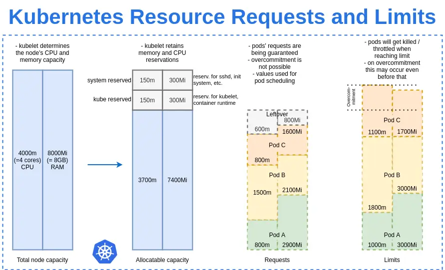
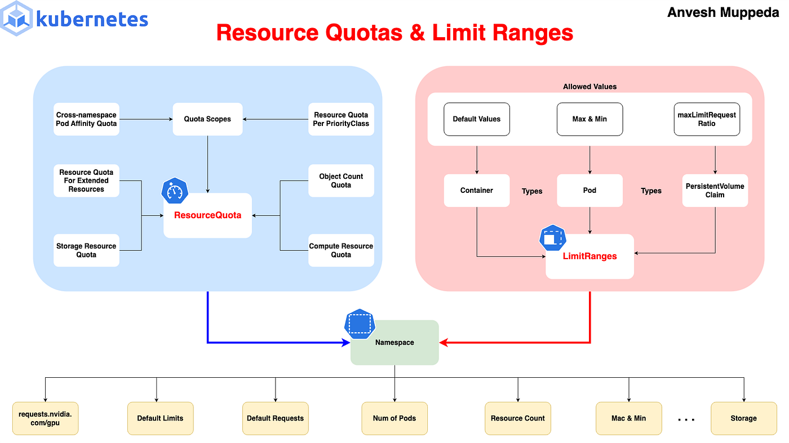
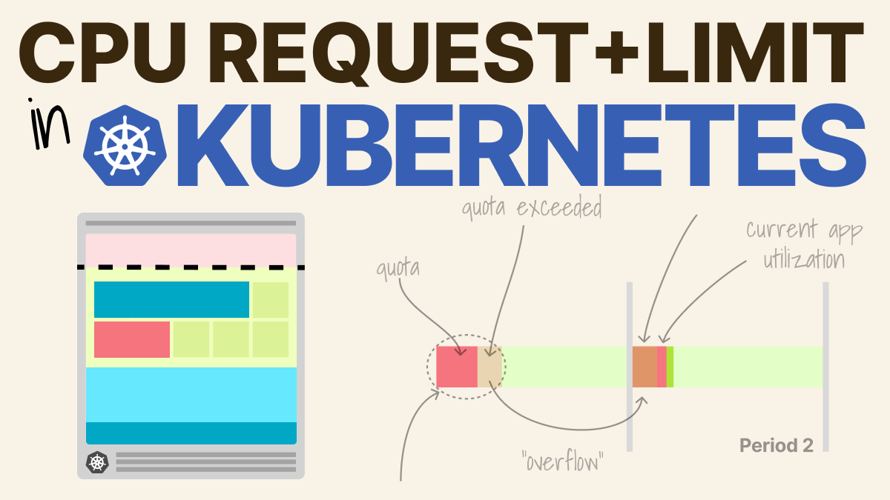
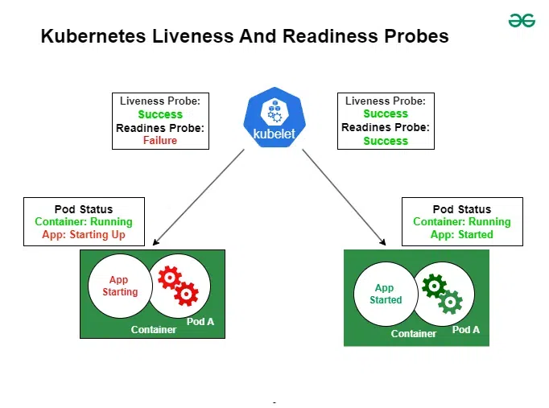

# TÌM HIỂU TỐI ƯU POD VỚI RESOURCE LIMITS VÀ REQUESTS
## Khái niệm
- Trong Kubernetes, mỗi container trong Pod có thể khai báo requests (yêu cầu tối thiểu) và limits (giới hạn tối đa) cho CPU và memory. Những giá trị này giúp scheduler quyết định node nào để chạy Pod và kubelet quản lý runtime.
- *Requests*: Lượng tài nguyên tối thiểu mà container yêu cầu để chạy. Scheduler sử dụng để chọn node có đủ allocatable resources (tổng node capacity trừ system/kube reserved). Nếu không đủ, Pod Pending. Requests cũng quyết định QoS class và priority khi evict.
- *Limits*: Giới hạn tối đa container có thể sử dụng. Nếu vượt (memory), container OOMKilled; nếu CPU, throttled (giảm tốc độ). Limits ngăn container “starve” các Pod khác trên node.
- Đơn vị:
    + CPU: 1 = 1 vCPU/core; 100m = 0.1 CPU.
    + Memory: Bytes (e.g., 256Mi = 256 mebibytes, 1Gi = 1 gibibyte).
    + Nếu không set, default từ LimitRange (nếu có) hoặc unlimited (rủi ro cao).
- Lợi ích tối ưu:
    + *Scheduling hiệu quả*: Scheduler fit Pods vào nodes phù hợp, tránh overcommit.
    + *Prevent failures*: Limits tránh OOM, requests đảm bảo minimum.
    + *QoS management*: Phân loại Pods để evict low-priority trước khi node stress.
    + *Cost optimization*: Tránh lãng phí cloud resources.
- Dưới đây là sơ đồ minh họa resource requests và limits trong Kubernetes, cho thấy cách chúng ảnh hưởng đến allocation và usage:


## Quality of Service (QoS) Classes và cách tính
- Dựa trên requests/limits, Kubernetes gán QoS class cho Pod (tổng từ tất cả containers):
    + Guaranteed: Requests = Limits (cho tất cả resources). Ưu tiên cao nhất, không evict trừ critical.
    + Burstable: Requests Burstable > Guaranteed.
- Ví dụ: Pod với CPU request 100m, limit 200m; memory request=limit=256Mi => Burstable (vì CPU burstable).
- Dưới đây là diagram QoS classes, minh họa cách phân loại dựa trên requests/limits:

**So sánh QoS Classes**

| QoS Class | Điều Kiện | Ưu Tiên Evict | Use Case |
|:---:|:---:|:---:|:---:|
| Guaranteed | Requests = Limits cho tất cả resources | Cao nhất | Critical apps cần guaranteed resources |
| Burstable | Requests < Limits cho ít nhất một resource | Trung bình | Apps burstable như web servers |
| BestEffort | Không set requests/limits | Thấp nhất | Non-critical, test apps |

## Cấu hình Resource Limits và Requests trong YAML
- Trong spec.containers[].resources (hoặc initContainers).
YAML ví dụ:
```bash
apiVersion: v1
kind: Pod
metadata:
  name: resource-pod
spec:
  containers:
    - name: app
      image: nginx
      resources:
        requests:
          cpu: "100m"     # 0.1 CPU
          memory: "128Mi"
        limits:
          cpu: "200m"
          memory: "256Mi"
```
- Multi-container: Tổng requests/limits cho Pod là sum của tất cả.
- Áp dụng: kubectl apply -f pod.yaml.
- Để xem: kubectl describe pod resource-pod (xem Resources section).
- Dưới đây là diagram OOMKilled debug, minh họa cách limits dẫn đến termination nếu vượt memory:


## Các lệnh Kubectl để quản lý Resources
- Xem resources Pod: `kubectl describe pod` (Resources field).
- Top usage: `kubectl top pod` (yêu cầu metrics-server).
- Edit resources: `kubectl edit pod` (sửa YAML, nhưng Pod immutable nên thường recreate).
- Get QoS: `kubectl get pod -o jsonpath='{.status.qosClass}'`
- Debug OOM: `kubectl describe pod` (xem Events: OOMKilled)

## Probes trong K8s
### Khái niệm
- Probes là các health check mà kubelet thực hiện định kỳ trên containers để kiểm tra trạng thái. Chúng giúp Kubernetes đưa ra quyết định thông minh: restart container nếu “dead” (liveness), hoặc remove/add Pod từ Service endpoints nếu not/ready for traffic (readiness). Probes đặc biệt quan trọng cho apps stateful hoặc có dependencies (e.g., wait DB connect).
- Lợi ích chính:
    + *Self-healing*: Tự động recover từ failures mà không cần manual intervention.
    + *Zero-downtime*: Readiness ngăn traffic đến Pods chưa ready, tránh user errors.
    + *Efficiency*: Giảm false positives từ container crashes, tối ưu resource.
    + *Types*: HTTPGet (check endpoint), TCPSocket (check port open), Exec (run command inside), GRPC (check gRPC health).
- Không dùng probes, Kubernetes chỉ dựa vào container exit code không đủ cho complex apps. Trong CKAD, probes xuất hiện thường xuyên ở tasks liên quan đến Pod reliability.
- Dưới đây là sơ đồ minh họa Kubernetes Liveness and Readiness Probes, cho thấy cách kubelet interact với Pod và hậu quả của success/failure:


### Liveness Probe: Phát hiện và khởi động lại container "Dead"
- Liveness probe kiểm tra nếu container còn “sống” (alive) nghĩa là app đang running đúng. Nếu fail (failureThreshold lần), kubelet restart container (theo restartPolicy).
- Use cases:
    + Detect deadlocks hoặc infinite loops (app unresponsive nhưng process alive).
    + Self-healing cho apps crash silently (e.g., Java OOM nhưng không exit).
- Nếu không set, default no liveness rủi ro Pods stuck mãi.
- Ví dụ: App web fail nếu DB down, liveness check DB connect, fail thì restart.
### Readiness Probe: Kiểm tra sẵn sàng nhận traffic
- Readiness probe kiểm tra nếu container ready for traffic. Nếu success, Pod added vào Service endpoints, nếu fail, removed (không restart, chỉ isolate traffic).
- Use cases:
    + Wait dependencies ready (e.g., DB init) trước khi serve requests.
    + Handle slow startup hoặc maintenance mode.
- Nếu không set, default ready ngay khi container start rủi ro traffic đến Pods chưa init.
### Startup Probe: Xử Lý Slow Startup
- Startup probe (beta từ 1.16, stable 1.20) check nếu app started (cho slow-start apps). Nếu fail, delay liveness/readiness để tránh premature restarts.
- Use case: Legacy apps load lâu (e.g., Java JVM warmup).
### Khác Biệt Giữa Probes Và Các Parameters Chung
    * Liveness: Fail => Restart container.
    * Readiness: Fail => No traffic (Pod vẫn Running).
    * Startup: Fail => Delay other probes.
- Parameters tuning (áp dụng cho tất cả):
    + *initialDelaySeconds*: Chờ bao lâu trước probe đầu (default 0).
    + *periodSeconds*: Khoảng cách giữa probes (default 10).
    + *timeoutSeconds*: Timeout cho probe (default 1).
    + *successThreshold*: Số success liên tiếp để coi healthy sau fail (default 1, min 1).
    + *failureThreshold*: Số fail liên tiếp để trigger action (default 3).
- Tune cẩn thận để tránh false positives/negatives.
### Các Type Probe và cấu hình trong file YAML
- Probes có 4 types: HTTPGet, TCPSocket, Exec, GRPC. Set trong `spec.containers[].livenessProbe` hoặc `readinessProbe/startupProbe`
```bash
apiVersion: v1
kind: Pod
metadata:
  name: probe-pod
spec:
  containers:
  - name: app
    image: nginx
    livenessProbe:  # HTTPGet example
      httpGet:
        path: /healthz
        port: 80
        scheme: HTTP  # or HTTPS
        httpHeaders: [{name: Custom-Header, value: Awesome}]
      initialDelaySeconds: 3
      periodSeconds: 3
      timeoutSeconds: 1
      failureThreshold: 3
    readinessProbe:  # Exec example
      exec:
        command: ["cat", "/tmp/healthy"]
      initialDelaySeconds: 5
      periodSeconds: 5
    startupProbe:  # TCP example
      tcpSocket:
        port: 8080
      failureThreshold: 30
      periodSeconds: 10
```
- *HTTPGet*: Check response code 200-399.
- *TCPSocket*: Check port open.
- *Exec*: Run command, exit 0 = success.
- *GRPC*: Check gRPC health (require app support).
### Các lệnh Kubectl để quản lý và Debug Probes
- *Xem probes*: kubectl describe pod probe-pod (xem Probes section, Events nếu fail).
- *Edit probes*: kubectl edit pod probe-pod (sửa YAML, nhưng Pod immutable nên thường recreate).
- *Debug fail*: kubectl get events | grep probe-pod (xem warning như ProbeFailed).
- *Check status*: kubectl get pod -o wide (xem READY column: 0/1 nếu readiness fail).
### Bảng tóm tắt Types Probes và Parameters
- **Types Probes**

| Type | Mô tả | YAML Example | Use Case |
|:---:|:---:|:---:|:---:|
| HTTPGet | Check HTTP endpoint (code 200-399) | httpGet: {path: /health, port: 80} | Web apps với health endpoint |
| TCPSocket | Check port open | tcpSocket: {port: 8080} | Services không HTTP (e.g., DB) |
| Exec | Run command inside, exit 0=success | exec: {command: [“pg_isready”]} | Custom scripts check DB/file |
| GRPC | Check gRPC health | grpc: {port: 50051, service: “echo.Echo”} | gRPC apps |

- **Parameters**

| Parameter | Mô tả | Default | Tuning Tip |
|:---:|:---:|:---:|:---:|
| initialDelaySeconds | Chờ trước probe đầu | 0 | Set cao cho slow start apps |
| periodSeconds | Khoảng cách probes | 10 | Giảm cho fast detect, tăng để giảm load |
| timeoutSeconds | Timeout probe | 1 | Tăng nếu check slow |
| failureThreshold | Fail liên tiếp để action | 3 | Tăng để tolerate transient fails |