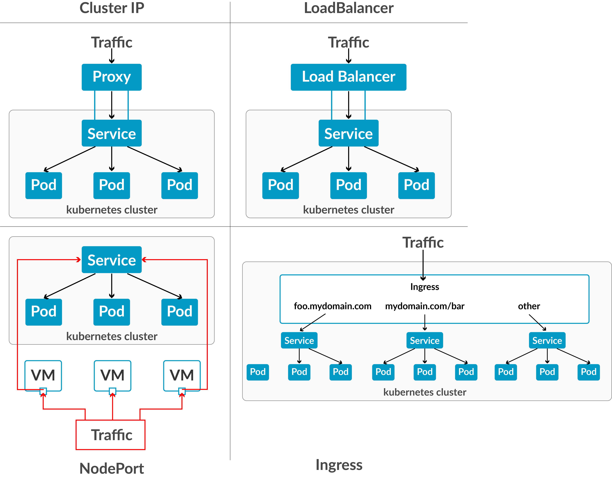

# TÌM HIỂU VỀ SERVICE TRONG K8S
## Khái niệm
- Service là một abstraction layer giúp bạn kết nối đến các Pod một cách ổn định, dù Pod có chết đi sống lại, IP thay đổi liên tục.

| Vấn đề | Giải pháp bằng Service |
|:---:|:---:|
| Pod có IP động => Không thể hardcode | Service có IP tĩnh (ClusterIP) |
| Nhiều Pod cùng Service => cần load balance | Service tự động round-robin |
| Cần expose ra ngoài cluster | Dùng NodePort hoặc LoadBalancer |

## Các loại Service trong Kubernetes
| Loại | Mục đích | Port mở | Dùng khi |
|:---:|:---:|:---:|:---:|
| ClusterIP (default) | Giao tiếp trong cluster | Chỉ nội bộ | API backend, DB, microservices |
| NodePort | Expose ra ngoài qua node | 30000–32767 | Dev/test, truy cập tạm thời |
| LoadBalancer | Expose qua cloud LB | Tùy cloud | Production (AWS ELB, GCP, etc.) |
| ExternalName | Map đến DNS bên ngoài | Không mở port | Gọi API bên ngoài |

Dưới đây là minh họa về các loại Service trong Kubernetes để bạn dễ hình dung:


## Cấu trúc file YAML cơ bản
```bash
apiVersion: v1
kind: Service
metadata:
  name: my-service
spec:
  selector:
    app: my-app
  ports:
    - protocol: TCP
      port: 80
      targetPort: 8080
  type: ClusterIP
```
- Giải thích nhanh:
    + *port*: cổng mà Service expose trong cluster.
    + *targetPort*: cổng container trong Pod.
    + *nodePort*: chỉ dùng khi type: NodePort.

## So sánh ClusterIP với NodePort
| Tiêu chí | ClusterIP | NodePort |
|:---:|:---:|:---:|
| type | Mặc định | NodePort |
| IP | Nội bộ | IP của Node |
| Port range | Tùy ý | 30000–32767 |
| Sử dụng | Microservices | Test, demo |
| Có nodePort? | Không | Có |
| Lệnh nhanh | kubectl expose | kubectl expose --type=NodePort |

## Debug Service không kết nối
| Lỗi | Nguyên nhân | Cách fix |
|:---:|:---:|:---:|
| Connection refused | Sai targetPort | Kiểm tra containerPort |
| Service not found | Sai tên | kubectl get svc |
| No endpoints | Sai selector | kubectl get pod -l app=xxx |
| Pending | Pod chưa ready | kubectl get pod |

- Debug nhanh:
```bash
kubectl describe svc nginx-service
kubectl get endpoints nginx-service
```