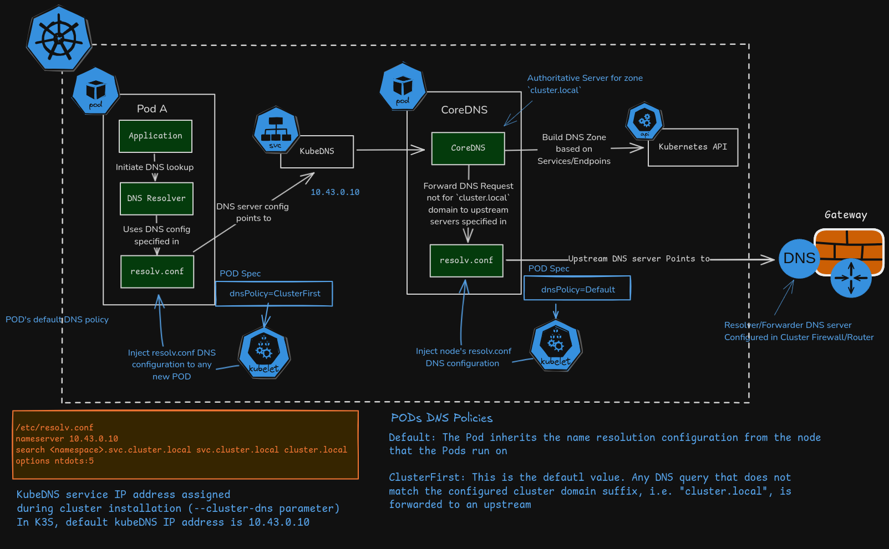
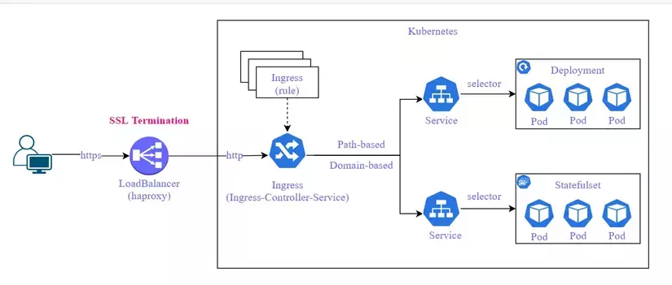

# TÌM HIỂU VỀ DNS VÀ LOAD BALANCING TRONG KUBERNETES
## Quản lý DNS trong Kubernetes

### DNS hoạt động như thế nào
- Khi bạn tạo một Service, Kubernetes sẽ tự động đăng ký DNS record cho Service đó trong CoreDNS. Mọi Pod trong cluster có thể truy cập Service này bằng tên DNS thay vì IP, ví dụ:
```bash
<service-name>.<namespace>.svc.cluster.local
```
- Ví dụ, Service web trong namespace default có thể được truy cập bằng:
```bash
web.default.svc.cluster.local
```
### Kiểm tra CoreDNS
- CoreDNS là thành phần chịu trách nhiệm phân giải DNS trong cluster. Kiểm tra trạng thái:
```bash
kubectl get pods -n kube-system -l k8s-app=kube-dns
kubectl logs -n kube-system -l k8s-app=kube-dns
```
### Các kiểu DNS Policy
| dnsPolicy | Ý nghĩa |
|:---:|:---:|
| ClusterFirst (default) | Dùng DNS của cluster để resolve các Service nội bộ. |
| Default | Dùng DNS cấu hình sẵn của node (thường là /etc/resolv.conf). |
| ClusterFirstWithHostNet | Dùng cho Pod có hostNetwork: true. |
| None | Tắt hoàn toàn, dùng dnsConfig tùy chỉnh. |

- Ví dụ file YAML:
```bash
apiVersion: v1
kind: Pod
metadata:
  name: dns-test
spec:
  containers:
  - name: test
    image: busybox
    command: ["sleep", "3600"]
  dnsPolicy: ClusterFirst
```
### Kiểm tra DNS Resolution
- Tạo Pod busybox để test DNS:
```bash
kubectl run test-dns --image=busybox --rm -it --restart=Never -- nslookup kubernetes.default
```
- Kết quả mong đợi:
```bash
Server:    10.96.0.10
Address:   10.96.0.10#53
Name:      kubernetes.default.svc.cluster.local
Address:   10.96.0.1
```
- Nếu lỗi “no such host” => kiểm tra lại CoreDNS và dnsPolicy.

## Load Balancing trong Kubernetes

### Load Balancing ở mức Service
- Khi bạn tạo một Service kiểu ClusterIP hoặc NodePort, kube-proxy sẽ tự động phân phối traffic đến các Pod backend theo cơ chế round-robin (ngẫu nhiên hoặc IPVS).

- Ví dụ: Service web trỏ đến 3 Pod chạy cùng image nginx, khi gửi nhiều request liên tiếp, kube-proxy sẽ điều hướng lần lượt đến các Pod khác nhau.
### Kiểm tra Load Balancing
- Tạo Deployment và Service mẫu:
```bash
apiVersion: apps/v1
kind: Deployment
metadata:
  name: web
spec:
  replicas: 3
  selector:
    matchLabels:
      app: web
  template:
    metadata:
      labels:
        app: web
    spec:
      containers:
      - name: nginx
        image: nginx:alpine
        ports:
        - containerPort: 80
        env:
        - name: POD_NAME
          valueFrom:
            fieldRef:
              fieldPath: metadata.name
```
- Expose bằng Service:
```bash
apiVersion: v1
kind: Service
metadata:
  name: web-svc
spec:
  selector:
    app: web
  ports:
  - port: 80
    targetPort: 80
  type: ClusterIP
```
- Test từ Pod khác:
```bash
kubectl run test --image=busybox --rm -it --restart=Never -- sh
wget -qO- web-svc
```
- Lặp nhiều lần lệnh wget để thấy response từ các Pod khác nhau => chứng minh load balancing hoạt động.
### Load Balancing với NodePort
- Nếu expose bằng NodePort:
```bash
apiVersion: v1
kind: Service
metadata:
  name: web-nodeport
spec:
  selector:
    app: web
  type: NodePort
  ports:
    - port: 80
      targetPort: 80
      nodePort: 30082
```
- Test từ host (Minikube)
```bash
curl http://$(minikube ip):30082
```