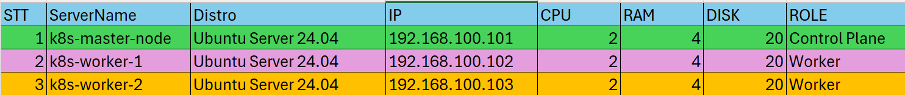
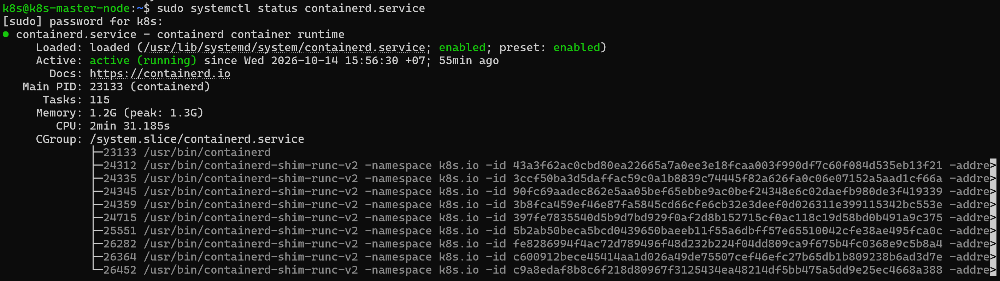
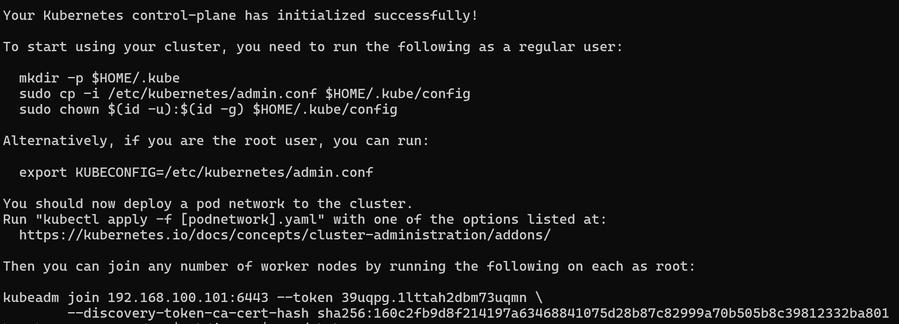
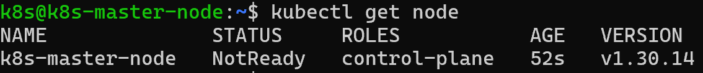
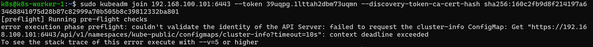
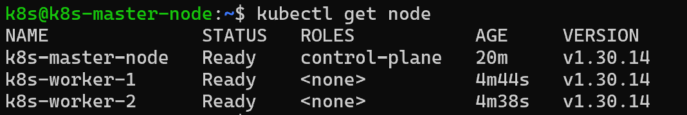

# THỰC HÀNH QUÁ TRÌNH DỰNG CỤM K8S SỬ DỤNG KUBEADM
## Quy hoạch

## Tiến hành cài đặt
### Các bước cần thiết trước khi cài đặt
**Thực hiện trên cả 3 node**
- Update và Upgrade hệ thống:
```bash
sudo apt update && sudo apt upgrade -y
```
- Thêm user mới vào hệ thống để cài cụm K8s bằng user này:
```bash
sudo adduser k8s
```
- Thêm user mới vào group `sudo`:
```bash
sudo usermode -aG sudo k8s
```
- Chuyển sang user k8s và bắt đầu dựng cụm K8s:
```bash
su k8s
```
- Tiến hành tắt swap trên hệ thống:
```bash
sudo swapoff -a
sudo sed -i '/swap.img/s/^/#/' /etc/fstab
```
**Giải thích:** tại sao phải tắt swap trên hệ thống ?
- Đảm bảo độ chính xác và hiệu năng của tài nguyên (Predictable Performance)
    + Kubernetes được thiết kế để phân phối tài nguyên tính toán (CPU, RAM) cho các container một cách chính xác và cam kết.
    + Nếu bật swap, khi RAM vật lý đầy, hệ thống Linux sẽ tự động đẩy các trang bộ nhớ ít dùng sang ổ cứng (swap). Việc này làm giảm tốc độ xử lý xuống rất nhiều lần, khiến các ứng dụng chạy trong container bị giật, chậm đột ngột và mất tính dự đoán về hiệu năng.
- Cơ chế giới hạn bộ nhớ (Memory Limits) của Pod
    + Khi bạn tạo một Pod, bạn thường giới hạn RAM cho phép của nó (ví dụ: tối đa 1GB).
    + Nếu hệ thống bật swap, khi một Pod vượt quá giới hạn RAM, thay vì bị hệ thống Kubernetes phát hiện và tiêu diệt (OOM Killed - Out Of Memory) theo đúng cơ chế quản lý container, hệ thống có thể sẽ âm thầm đẩy phần thừa đó sang swap. Điều này làm sai lệch hoàn toàn cơ chế giám sát và kiểm soát tài nguyên của Kubernetes.
- Sự đồng bộ giữa kubelet và bộ nhớ hệ thống
    + Thành phần quản lý node của Kubernetes là kubelet được thiết kế để tính toán chính xác dung lượng RAM trống còn lại trên máy chủ nhằm quyết định xem có nên đưa thêm Pod mới vào node đó hay không.
    + Sự tồn làm việc của swap sẽ làm cho các thuật toán tính toán dung lượng trống của kubelet bị sai lệch, dẫn đến việc lập lịch cấp phát container bị lỗi hoặc quá tải hệ thống phần cứng mà Kubernetes không kiểm soát được.
### Cài đặt containerd
**Thực hiện trên cả 3 nodes**
- Cấu hình module kernel:
```bash
sudo nano /etc/modules-load.d/containerd.conf
```
+ Thêm nội dung sau vào file:
```bash
overlay
br_netfilter
```
- Tải module kernel:
```bash
sudo modprobe overlay
sudo modprobe br_netfilter
```
- Cấu hình hệ thống mạng:
```bash
echo "net.bridge.bridge-nf-call-ip6tables = 1" | sudo tee -a /etc/sysctl.d/kubernetes.conf
echo "net.bridge.bridge-nf-call-iptables = 1" | sudo tee -a /etc/sysctl.d/kubernetes.conf
echo "net.ipv4.ip_forward = 1" | sudo tee -a /etc/sysctl.d/kubernetes.conf
```
- Áp dụng cấu hình sysctl:
```bash
sudo sysctl --system
```
- Cấu hình các gói cần thiết cho containerd:
```bash
sudo apt install -y curl gnupg2 software-properties-common apt-transport-https ca-certificates
sudo curl -fsSL https://download.docker.com/linux/ubuntu/gpg | sudo gpg --dearmour -o /etc/apt/trusted.gpg.d/docker.gpg
sudo add-apt-repository "deb [arch=amd64] https://download.docker.com/linux/ubuntu $(lsb_release -cs) stable"
```
- Cài đặt containerd:
```bash
sudo apt update -y 
sudo apt install -y containerd.io
```
- Cấu hình containerd:
``` bash
containerd config default | sudo tee /etc/containerd/config.toml >/dev/null 2>&1
sudo sed -i 's/SystemdCgroup = false/SystemdCgroup = true/g' /etc/containerd/config.toml
```
- Khởi động containerd:
```bash
sudo systemctl restart containerd
sudo systemctl enable containerd
```

### Cài đặt Kubelet, kubeadm, kubectl
- Thêm kho lưu trữ Kubernetes:
```bash
echo "deb [signed-by=/etc/apt/keyrings/kubernetes-apt-keyring.gpg] https://pkgs.k8s.io/core:/stable:/v1.30/deb/ /" | sudo tee /etc/apt/sources.list.d/kubernetes.list
curl -fsSL https://pkgs.k8s.io/core:/stable:/v1.30/deb/Release.key | sudo gpg --dearmor -o /etc/apt/keyrings/kubernetes-apt-keyring.gpg
```
- Cài đặt các gói Kubernetes:
```bash
sudo apt update -y
sudo apt install -y kubelet kubeadm kubectl
sudo apt-mark hold kubelet kubeadm kubectl
```
### Triển khai 1 Master - 2 Worker
- Chạy lệnh trên `master-node`
```bash
sudo kubeadm init
```

- Thực hiện các câu lệnh như hướng dẫn:
```bash
mkdir -p $HOME/.kube
sudo cp -i /etc/kubernetes/admin.conf $HOME/.kube/config
sudo chown $(id -u):$(id -g) $HOME/.kube/config
```
- Kiểm tra các node:

Trạng thái của node đang là `NotReady` vì ta chưa cài network cho cụm k8s nên nó chưa thể kéo các tài nguyên về
**Thực hiện trên 2 node Worker (k8s-worker-1 và k8s-worker-2)**
```bash
sudo kubeadm join 192.168.100.101:6443 --token 39uqpg.1lttah2dbm73uqmn --discovery-token-ca-cert-hash sha256:160c2fb9d8f214197a63468841075d28b87c82999a70b505b8c39812332ba801
```
- Nếu trong bước này mà bị báo lỗi như hình dưới thì tiến hành tắt firewall trên master node:

```bash
sudo ufw disable
```
Hoặc mở các port cần thiết trên tất cả các Node
+ Master node:
```bash
sudo ufw allow 6443/tcp
sudo ufw allow 2379:2380/tcp
sudo ufw allow 10250/tcp
sudo ufw allow 10259/tcp
sudo ufw allow 10257/tcp
sudo ufw reload
```
+ Worker Node:
```bash
sudo ufw allow 10250/tcp
sudo ufw allow 30000:32767/tcp
sudo ufw reload
```
**Chức năng của từng port:**
- Cổng 6443/tcp (Kubernetes API Server)
    + Chức năng: Đây là "trái tim" của toàn bộ cụm Kubernetes.
    + Tại sao phải mở: Mọi lệnh từ bạn (gõ qua kubectl), mọi giao tiếp từ các Worker Node (kubelet), hay các tiến trình nội bộ đều phải gửi về API Server qua cổng này để yêu cầu thay đổi trạng thái cụm.
- Cổng 2379 và 2380/tcp (etcd)
    + Chức năng: Cổng dùng cho etcd – cơ sở dữ liệu phân tán kiểu key-value của Kubernetes.
    + Tại sao phải mở: Nơi lưu trữ toàn bộ trạng thái, cấu hình, dữ liệu của tất cả các đối tượng trong cụm (Pod, Service, Secret...). Mọi thông tin về cụm đều nằm ở đây.
- Cổng 10250/tcp (Kubelet API)
    + Chức năng: Cổng giao tiếp của Kubelet (tác nhân chạy trên mỗi node để quản lý các container).
    + Tại sao phải mở: Master Node cần kết nối vào cổng này của các Worker Node để ra lệnh khởi động, theo dõi, lấy thông số tài nguyên hoặc logs của các Pod đang chạy trên đó.
- Cổng 10259/tcp và 10257/tcp (Scheduler và Controller Manager)
    + Chức năng: Dành cho các tiến trình điều phối nội bộ (kube-scheduler quyết định Pod nào chạy ở node nào, và kube-controller-manager duy trì trạng thái mong muốn của cụm).
    + Tại sao phải mở: Cho phép các thành phần quản lý cốt lõi lắng nghe và trao đổi dữ liệu an toàn với nhau trên Master Node.
- Sau đó tiến hành kiểm tra lại trên node Master:

### Thêm Network cho cụm K8s
```bash
kubectl apply -f https://raw.githubusercontent.com/projectcalico/calico/v3.28.0/manifests/calico.yaml
```
- Vậy là cụm K8s đã được cấu hình thành công :'D