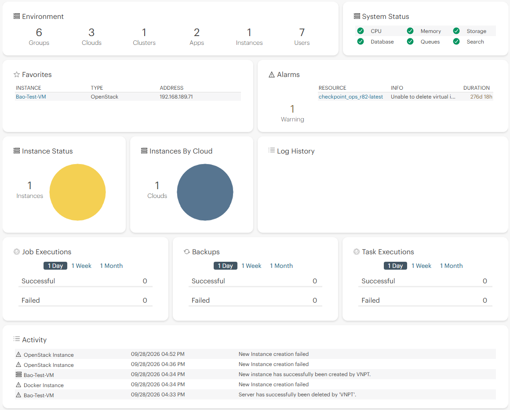
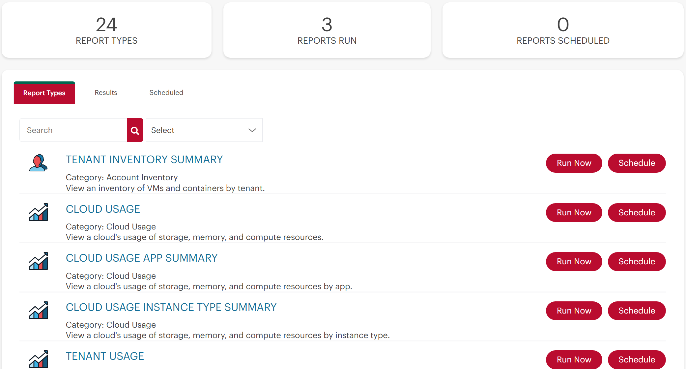
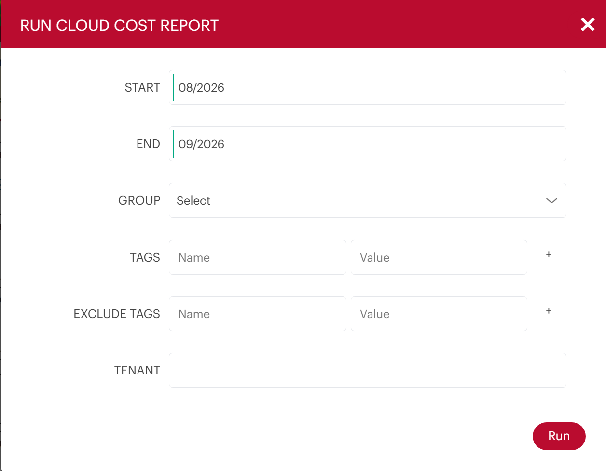
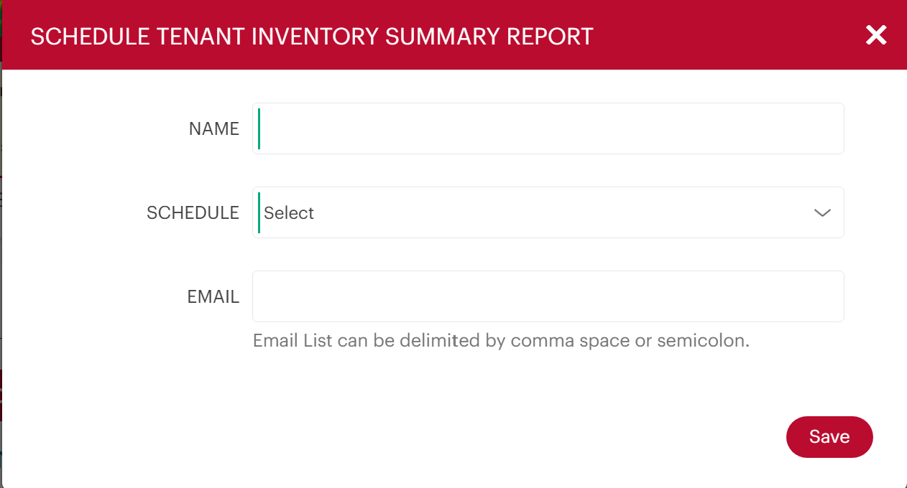
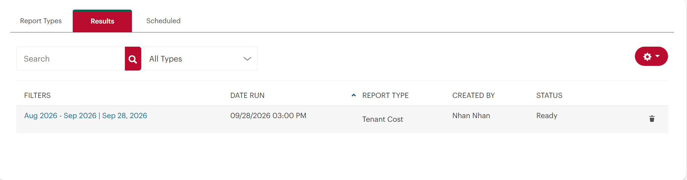

# TÌM HIỂU VỀ HPE MORPHEUS
## Operation
### Dashboard
#### Dashboard
Bảng điều khiển (Dashboard) cung cấp cái nhìn tổng quan cấp cao về môi trường của bạn, bao gồm thông tin về hiệu năng và cấu hình dễ đọc. Trong nhiều trường hợp, các khu vực khác trong giao diện người dùng HPE Morpheus Enterprise sẽ cho phép bạn xem chi tiết hơn thông tin được trình bày trên bảng điều khiển.

#### Environment
- Group: Tổng số nhóm hiện đang được tạo
- Cloud: Tổng số đám mây hiện đang được tích hợp
- Cluster: Tổng số cụm hiện đang được cung cấp.
- Apps: Tổng số ứng dụng hiện đang được cung cấp.
- Instances: Tổng số phiên bản hiện đang được cấp phát.
- Users: Tổng số tài khoản người dùng HPE Morpheus Enterprise
#### System Status
- Trạng thái hệ thống cung cấp cái nhìn tổng quan về tình trạng hoạt động của thiết bị. Thông tin chi tiết hơn có thể được xem trên trang chi tiết tình trạng thiết bị ( Quản trị > Tình trạng ) và phần giải thích chi tiết hơn về ý nghĩa của từng chỉ báo trạng thái có trong tài liệu về tình trạng của HPE Morpheus Enterprise .
#### Favorites
- Mọi phiên bản bạn đã "đánh dấu yêu thích" sẽ xuất hiện ở đây cùng với tên phiên bản, loại và địa chỉ IP.
#### Alarms
- Năm cảnh báo gần đây nhất được hiển thị ở đây và người dùng có thể nhấp vào liên kết để truy cập tài nguyên đã kích hoạt cảnh báo. Để xem danh sách đầy đủ các cảnh báo và biết thêm thông tin về từng cảnh báo, hãy truy cập vào Hoạt động > Hoạt động > Cảnh báo.
#### Instances Status
- Tổng số lượng Instance được liệt kê cùng với biểu đồ hình tròn thể hiện trạng thái của từng Instance. Di chuột qua từng phần của biểu đồ hình tròn để xem tổng số lượng và tỷ lệ phần trăm Instance ở trạng thái đó. Các trạng thái có thể bao gồm đang chạy, đã dừng, đang cấp phát, và nhiều trạng thái khác.
#### Instances By Cloud
- Biểu đồ hiển thị tổng số lượng Cloud hiện đang có Instance được cấp phát. Di chuột qua từng phần của biểu đồ hình tròn để xem tổng số lượng và tỷ lệ phần trăm Instance được cấp phát cho mỗi Cloud.
#### Daily Cloud Instances
- Số lượng Instance hiện có tại bất kỳ thời điểm nào trong ngày, kèm theo phân tích chi tiết để hiển thị số lượng Instance được cấp phát cho mỗi Cloud. Con số này bao gồm bất kỳ Instance nào đã tồn tại từ những ngày trước đó, cùng với bất kỳ Instance mới nào được cấp phát và tồn tại trong ngày hôm đó, dù chỉ trong thời gian ngắn.
#### Group Workloads
- Số lượng tức thời của các bản ghi máy chủ hoặc vùng chứa được phân loại theo nhóm.
#### Cloud Workloads
- Số lượng tức thời các bản ghi máy chủ hoặc vùng chứa được phân loại theo liên kết đám mây.
#### Cluster Workloads
- Số lượng container được quản lý tức thời, được phân loại theo liên kết Cụm.
#### Log History
- Lịch sử nhật ký hiển thị ảnh chụp nhanh các khoảng thời gian khác nhau trong ngày hiện tại và số lượng nhật ký được tạo ra trong mỗi khoảng thời gian. Di chuột qua bất kỳ thanh nào trên biểu đồ để xem phân tích chi tiết về mức độ nghiêm trọng của nhật ký trong mỗi khoảng thời gian.
#### Log Trends
- Xu hướng nhật ký (Log Trends) xác định và liệt kê các thông báo lặp lại được tìm thấy trong các nhật ký dài gần đây. Nếu muốn, bạn có thể lọc chế độ xem này để chỉ hiển thị các thông báo nhật ký ở cấp độ Lỗi hoặc Cảnh báo.
#### Job Executions
- Hiển thị số lượng công việc được thực thi thành công và không thành công trong ngày, tuần hoặc tháng gần nhất.
#### Backups
- Hiển thị số lượng bản sao lưu thành công và không thành công trong ngày, tuần hoặc tháng gần nhất.
#### Task Executions
- Hiển thị số lượng tác vụ được thực thi thành công và không thành công trong ngày, tuần hoặc tháng gần nhất.
#### Activity
- Danh sách hoạt động hiển thị một vài sự kiện gần đây nhất đã diễn ra trong HPE Morpheus Enterprise bởi bất kỳ người dùng nào. Đó có thể là các khối lượng công việc được cấp phát mới, khối lượng công việc bị xóa, sao lưu hoặc một số hoạt động khác. Bạn có thể xem danh sách đầy đủ hơn về các hoạt động gần đây trong Operations > Activity

### Reports
#### Overview
- HPE Morpheus Enterprise cung cấp 28 loại báo cáo khác nhau được thiết kế để phân tích chi phí và mức sử dụng trên các đám mây, người dùng và nhiều hơn nữa. Các báo cáo có thể được chạy theo yêu cầu khi cần hoặc có thể được lên lịch chạy theo các khoảng thời gian nhất định để xem vào thời điểm sau đó. Danh sách các loại báo cáo có sẵn có thể được xem tại Operations > Reports .

#### Report Types
> ACCOUNT INVENTORY
Tóm tắt thông tin người thuê nhà
> CLOUD USAGE
- Sử dụng đám mây
- Tóm tắt ứng dụng sử dụng đám mây
- Tóm tắt loại phiên bản sử dụng đám mây
- Sử dụng của người thuê
> CLOUD COST
- Phạm vi bảo hiểm đặt chỗ của Amazon
- Tỷ lệ sử dụng đặt chỗ của Amazon
- Tóm tắt hàng tồn kho tiết kiệm của Amazon
- Bảo hiểm theo chương trình tiết kiệm của Amazon
- Sử dụng chương trình tiết kiệm của Amazon
- Chi phí đăng ký
- Chi phí đám mây
- Chi phí nhóm
- Chi phí instances
- Chi phí tenant
- Chi phí chuỗi thời gian
> INFRASTRUCTURE INVENTORY
- Tóm tắt thông tin về kho lưu trữ đám mây
- Tóm tắt thông tin máy chủ container
- Tóm tắt kiểm kê nhóm
- Hướng dẫn
- Tóm tắt danh mục Hypervisor
- Lập kế hoạch migration
- Phân bổ nguồn lực cho người thuê
> PROVISIONING INVENTORY
- Tóm tắt kho dữ liệu
- Kiểm kê phần mềm
- Kiểm kê phần mềm theo máy chủ
- Tuân thủ thẻ (tag)
- Tóm tắt danh mục máy ảo
- Tóm tắt khối lượng công việc
Bằng cách nhấp vào loại báo cáo, người dùng có thể xem bất kỳ lần chạy nào trước đó và lịch trình báo cáo đang hoạt động. Từ đây, người dùng có thể tạo, chỉnh sửa hoặc xóa các lần chạy theo yêu cầu mới và lịch trình mới cho loại báo cáo đã chọn. Một vài phần tiếp theo sẽ đi sâu hơn vào việc tạo, chỉnh sửa, lên lịch, xem và xóa báo cáo.
> Create Reports
- Để tạo báo cáo mới, hãy điều hướng đến trang danh sách loại báo cáo ( Hoạt động > Báo cáo ). Nhấp vào CHẠY NGAY ở bên phải loại báo cáo cụ thể để mở trình hướng dẫn chạy báo cáo đó. Các trường bắt buộc và tùy chọn để chạy loại báo cáo đã chọn sẽ xuất hiện, ví dụ, bảng cấu hình cho báo cáo Chi phí phiên bản được hiển thị bên dưới:

- Trong trường hợp này, chúng ta có thể chọn phạm vi báo cáo theo ngày bắt đầu và kết thúc, Nhóm, Đám mây, Người thuê và có thể bao gồm hoặc loại trừ cụ thể các Phiên bản dựa trên thẻ. Sau khi báo cáo được chạy, nó sẽ hiển thị trong danh sách báo cáo Chi phí Phiên bản và tất cả các báo cáo cho đến khi bị xóa.
> Schedule Reports
- Ngoài khả năng chạy báo cáo theo yêu cầu, HPE Morpheus Enterprise còn cho phép lên lịch báo cáo. Điều này giúp bạn lưu cấu hình báo cáo và truy cập thông tin được cập nhật theo lịch trình bạn cần.
- Quy trình lên lịch báo cáo gần như giống hệt với việc chạy theo yêu cầu. Từ trang danh sách loại báo cáo ( Hoạt động > Báo cáo ), hãy nhấp vào LỊCH ở bên phải loại báo cáo bạn muốn lên lịch. Các trường bắt buộc và tùy chọn để lên lịch cho loại báo cáo đã chọn sẽ xuất hiện, ví dụ, bảng cấu hình cho báo cáo Chi phí phiên bản được hiển thị bên dưới:

- Trong trường hợp này, chúng ta có thể chọn phạm vi báo cáo theo ngày bắt đầu và kết thúc, Nhóm, Đám mây, Người thuê và có thể cụ thể bao gồm hoặc loại trừ các Phiên bản dựa trên thẻ. Ngoài ra, chúng ta chọn lịch trình thời gian mà báo cáo này sẽ tự động chạy. Cuối cùng, chúng ta có thể chọn thêm danh sách địa chỉ email được phân tách bằng dấu phẩy, những địa chỉ này sẽ nhận được liên kết đến báo cáo qua email mỗi khi báo cáo được chạy.
> Viewing Results
Bạn có thể xem danh sách tất cả các lần chạy báo cáo trên tab Kết quả của trang danh sách loại báo cáo ( Thao tác > Báo cáo ). Để xem báo cáo, hãy nhấp vào các bộ lọc báo cáo có liên kết. Chỉ những báo cáo sẵn sàng để xem mới có liên kết hoạt động trên các bộ lọc của chúng. Ngoài các bộ lọc báo cáo, ngày chạy, loại báo cáo, người tạo và trạng thái chạy cũng được hiển thị. Nhấp vào bất kỳ tiêu đề nào trong số này để lọc danh sách báo cáo theo cột đó theo thứ tự tăng dần hoặc giảm dần. Bạn có thể xóa bất kỳ báo cáo nào bằng cách nhấp vào biểu tượng thùng rác ở cuối hàng của báo cáo đó.

> Viewing Schedules
Bạn có thể xem danh sách tất cả các lần chạy báo cáo đã lên lịch trong tab Đã lên lịch của trang danh sách loại báo cáo ( Thao tác > Báo cáo ). Tên thân thiện của lịch trình báo cáo được hiển thị cùng với loại báo cáo, thời gian chạy lần cuối, thời gian chạy tiếp theo và trạng thái thành công của lần chạy trước. Bạn có thể chỉnh sửa hoặc xóa lịch trình bằng cách nhấp vào biểu tượng bút chì hoặc thùng rác tương ứng. Chúng ta cũng có thể xem lần chạy gần đây nhất của một lịch trình nhất định (nếu thành công) bằng cách nhấp vào giá trị "lần chạy cuối" được liên kết.
## Provisioning
### Catalog
#### Catalog
Danh mục cung cấp giao diện tự phục vụ đơn giản, nơi người dùng có thể chọn và triển khai các Phiên bản, Bản thiết kế hoặc Quy trình công việc với cấu hình được xác định trước chỉ bằng vài cú nhấp chuột mà không cần phải xem quá nhiều tùy chọn. Các lựa chọn được hiển thị dưới dạng ô và người dùng có thể thêm các mặt hàng vào giỏ hàng như khi mua sắm trên một trang web thương mại điện tử. Đối với những người dùng thường xuyên thiết lập từ một số ít Loại Phiên bản và cấu hình, danh mục là một lựa chọn dễ dàng hơn so với trình hướng dẫn thiết lập Phiên bản chi tiết và nhiều tùy chọn hơn.

#### Cấu hình quyền truy cập mục trong danh mục
Trong Danh mục, người dùng được hiển thị các lựa chọn dựa trên Vai trò người dùng của họ. Ngoài ra, quyền truy cập vào các mục trong Danh mục có thể được thiết lập dựa trên Vai trò người thuê để hạn chế quyền truy cập vào một số mục nhất định đối với tất cả người dùng trong nhóm. Theo mặc định, Vai trò người dùng không có quyền truy cập vào bất kỳ mục nào trong danh mục. Do đó, quản trị viên cần phải cho phép quyền truy cập vào một số mục trong Danh mục để người dùng có thể sử dụng chế độ xem này.

Cấu hình quyền truy cập toàn cầu:

Đầy đủ: Cho phép truy cập vào tất cả các mục trong Danh mục

Tùy chỉnh: Cho phép truy cập vào các mục được chọn riêng lẻ từ danh sách bên dưới.

Không có: Không được phép truy cập vào bất kỳ mục nào trong Danh mục.

### Instances
#### Creating Instances
- Danh mục Instance là nơi tập trung mọi thứ để lựa chọn các thành phần cần được cấp phát và ghép nối với nhau. Nó không chỉ chứa các tùy chọn container và VM cơ bản mà còn cả các dịch vụ được thiết kế riêng cho cơ sở dữ liệu SQL, cơ sở dữ liệu NoSQL, kho lưu trữ bộ nhớ đệm, bus thông báo, máy chủ web và thậm chí cả các ứng dụng hoàn chỉnh. Danh sách này chứa rất nhiều mục để lựa chọn và chúng được hiển thị cho người dùng dựa trên các công cụ cấp phát nào được kích hoạt và tích hợp trong môi trường HPE Morpheus Enterprise.
- Để bắt đầu, chỉ cần nhấp vào nút + Thêm ở góc trên bên phải của mục Cung cấp > Phiên bản . Một cửa sổ bật lên sẽ hiển thị cho phép bạn tìm kiếm trong danh mục. Sau khi chọn được mục, chỉ cần làm theo các bước trong trình hướng dẫn.
- Bước tiếp theo sẽ yêu cầu chọn Nhóm và Đám mây. Nhóm là một đại diện trừu tượng có thể chứa nhiều tích hợp đám mây. Các đám mây có thể thuộc nhiều Nhóm và Nhóm cũng hữu ích để sử dụng RBAC nhằm hạn chế quyền truy cập cấp phát và thiết lập chính sách lưu giữ. Nếu môi trường là mới và các thiết lập này chưa tồn tại, bạn nên tham khảo một trong các hướng dẫn dành cho người mới bắt đầu của chúng tôi, chẳng hạn như hướng dẫn về cách bắt đầu sử dụng HPE Morpheus Enterprise và VMware . Trình hướng dẫn tiếp tục bằng cách cho phép chúng ta chọn tên cho Phiên bản cũng như môi trường.
- Tiếp theo, đã đến lúc cấu hình Instance. Tùy thuộc vào Cấu hình Instance được chọn, các trường sẽ thay đổi. Điều này có thể bao gồm các trường dành riêng cho nền tảng đám mây (ví dụ: Datastore cho VMware hoặc Mạng). Cũng sẽ có các tùy chọn như thiết lập tài khoản người dùng ban đầu. Một số trường này là tùy chọn và sẽ được hiển thị rõ ràng.
- Các tùy chọn cấu hình được cung cấp trong màn hình này rất mạnh mẽ. Ví dụ, với MySQL, bạn có thể chọn bố cục Master/Slave hoặc Master/Master. Các cấu hình này sẽ tự động triển khai hai máy ảo hoặc container MySQL và liên kết chúng với nhau để cung cấp khả năng sao chép dữ liệu. Các loại cấu hình này tồn tại cho nhiều loại Instance khác nhau và được tối ưu hóa cho hiệu suất cao và khả năng mở rộng. Thậm chí, bạn còn có thể cung cấp toàn bộ cụm MongoDB phân mảnh.
- Bước cuối cùng trước khi có thể cấp phát Instance là bước Tự động hóa. Bước hướng dẫn này có thể xuất hiện hoặc không tùy thuộc vào khả năng của loại Instance hoặc các cấu hình trước đó trong tài khoản. Tại đây, bạn có thể dễ dàng chọn một quy trình làm việc sau khi cấp phát để chạy (xem thêm về Tác vụ và Quy trình làm việc ở các phần khác trong tài liệu HPE Morpheus Enterprise ), chỉ định bộ cân bằng tải hoặc thậm chí cấu hình công việc sao lưu được tạo ra.
- Sau khi hoàn tất các bước cấp phát loại Instance đã chọn, chỉ cần xem lại các lựa chọn của bạn và hoàn tất. Instance sẽ tự động hiển thị trong danh sách Instance và trạng thái cấp phát của nó sẽ được hiển thị. Tùy thuộc vào loại Instance đã được cấp phát, bước này có thể mất từ ​​vài giây đến vài phút (thông thường cấu hình container sẽ khá nhanh nếu loại Instance đó đã được cấp phát trước đó).

#### Converting Discovered Resources to Managed Instances
- Khi tạo các tích hợp đám mây mới (hoặc cập nhật các tích hợp hiện có), người dùng có thể chọn HPE Morpheus Enterprise để tự động thêm bất kỳ tài nguyên hiện có nào đang nằm trên đám mây. Ví dụ, đó có thể là các máy ảo tồn tại trên máy chủ vCenter trước khi tích hợp với HPE Morpheus Enterprise , các phiên bản EC2 hiện có trên tài khoản Amazon AWS hoặc các máy ảo đang chạy trên máy chủ KVM. Khi cửa sổ Thêm/Chỉnh sửa Đám mây đang mở, hãy đánh dấu INVENTORY EXISTING INSTANCES để HPE Morpheus Enterprise tự động thêm các tài nguyên này. HPE Morpheus Enterprise không chỉ kiểm kê các phiên bản này tại thời điểm tích hợp (hoặc cập nhật) đám mây mà còn tiếp tục thăm dò đám mây mục tiêu sau mỗi năm phút (theo mặc định) để tìm các máy chủ mới được thêm hoặc xóa. Người dùng có thể xem các máy chủ được phát hiện này bằng cách xem trong Infrastructure > Compute . Tùy thuộc vào loại tài nguyên, nó có thể xuất hiện trên tab Máy ảo, tab Container hoặc một tab khác. Ngoài ra, chúng ta có thể xem danh sách các máy chủ được phát hiện trên các trang chi tiết Đám mây ( Infrastructure > Clouds > Selected Cloud). Chỉ cần nhấp vào các tab VM, Container hoặc Host. Các tài nguyên được phát hiện sẽ được hiển thị rõ ràng, trong khi các container được liên kết với một Instance được quản lý sẽ được đánh dấu là "Đã quản lý".
- Ngoài ra, HPE Morpheus Enterprise cho phép người dùng chuyển đổi các tài nguyên đã được phát hiện thành các Instance được quản lý. Bắt đầu từ trang chi tiết máy chủ ( Cơ sở hạ tầng > Tính toán > Máy ảo > máy đã chọn) và từ menu HÀNH ĐỘNG, chọn “Chuyển đổi thành Instance được quản lý”. Tại bước này, chúng ta cần thực hiện một số lựa chọn:
    + Giao cho Người thuê chính hoặc một trong những Người thuê phụ.
    + Chọn một Nhóm (menu thả xuống này chứa danh sách các Nhóm đã được lọc mà Cloud liên kết thuộc về)
    + Tên người dùng và mật khẩu cho tài khoản đã được gieo hạt
    + Bạn có thể chọn cài đặt HPE Morpheus Enterprise Agent hoặc không (để biết thêm thông tin về HPE Morpheus Enterprise Agent, hãy nhấp vào đây )
    + Chọn Loại Phiên bản (Instance Type) cần được liên kết với Phiên bản mới chứa Máy ảo này.
    + Chọn số phiên bản cho máy ảo (ví dụ: 20.04 cho máy ảo Ubuntu cơ bản).
    + Chọn bố cục; các loại đối tượng thường có nhiều cấu hình bố cục khác nhau.
    + Xác định OS
    + Chọn `Plan` (menu thả xuống này chứa danh sách các gói dịch vụ đã được lọc tương ứng với kích thước của máy ảo)
- Cuối cùng, nhấp vào THỰC HIỆN . Sau khi quá trình này hoàn tất, máy chủ sẽ được hiển thị là “Đã quản lý” trong danh sách máy chủ. Ngoài ra, một Instance mới sẽ xuất hiện trên trang Danh sách Instance ( Cung cấp > Instance ). Giờ đây, chúng ta có thể làm việc với nó theo cách tương tự như với bất kỳ Instance nào khác, chẳng hạn như thêm nó vào một Ứng dụng hoặc mở rộng Instance theo chiều ngang bằng cách thêm các node.
## Library

## Infrastructure
### Network

## Backups

## Monitoring

## Tools

## Administration