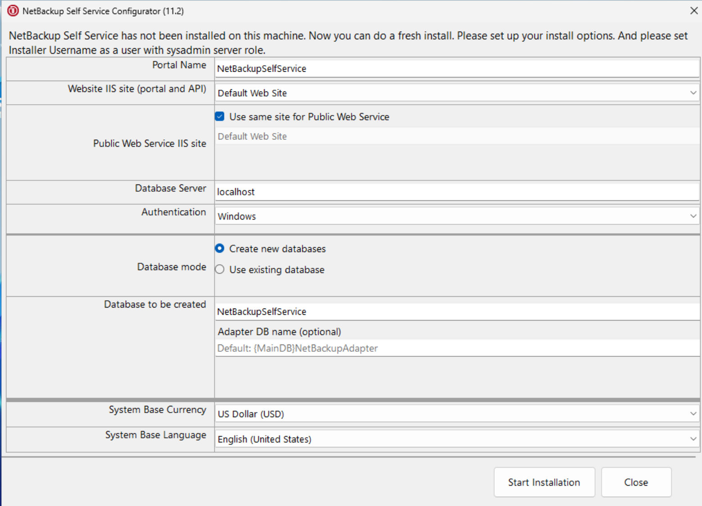
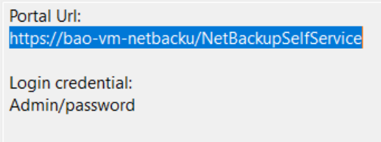

# CÀI ĐẶT NET BACK UP SELF-SERVICE ĐỂ TÍCH HỢP VÀO CMP
## Yêu cầu
- Cần có một VM chạy Windows Server
- SQL Server để lưu trữ
## Thực hiện
- Đầu tiên ta sẽ cài đặt các thành phần trên máy Windows Server, mở `PowerShell` bằng quyền `Administrator` và chạy câu lệnh dưới đây
```bash
Install-WindowsFeature -Name Web-Server, Web-Mgmt-Tools, Web-Asp-Net45, NET-Framework-45-ASPNET -IncludeManagementTools
```
- Sau khi cài đặt xong, tiến hành tải các thành phần quan trọng như file cài đặt NBU, SQL Server 2022 Express
- Tiến hành cài đặt SQL Server 2022 Express, sau khi cài đặt xong thì ở `Authentication Mode` chọn chế độ `Mixed Mode`
- Đặt mật khẩu cho tài khoản quản trị sa
- Kích hoạt giao thức TCP/IP
```bash
# 1. Đổi chế độ xác thực SQL Server sang Mixed Mode (giá trị = 2)
Set-ItemProperty -Path 'HKLM:\SOFTWARE\Microsoft\Microsoft SQL Server\MSSQL16.SQLEXPRESS\MSSQLServer' -Name 'LoginMode' -Value 2
# 2. Khởi động lại dịch vụ SQL Server để áp dụng thay đổi
Restart-Service -Name "MSSQL`$SQLEXPRESS" -Force
```
```bash
# Cài mật khẩu cho tài khoản sa
sqlcmd -S "localhost\SQLEXPRESS" -E -Q "ALTER LOGIN sa WITH PASSWORD = 'YourStrongPassword@2026', CHECK_POLICY = OFF; ALTER LOGIN sa ENABLE;"
```
- Tiến hành cài đặt NBU, giải nén file NBU đã tải về và chạy file `setup.exe` bằng quyền Administrator
- Khi này hệ thống sẽ hiển thị các thành phần cần cài đặt trong hệ thống, nhấn Install và đợi
- Xong khi cài đặt xong thì chạy lại file `setup.exe` bằng quyền Admin nếu cửa sổ NBU không hiển thị lại
- Khi đến bước này, ta sẽ cần thay đổi 1 số thông tin sau

- **Các giá trị cần điền:**
    + *Portal Name*: Giữ nguyên NetBackupSelfService.
    + *Website IIS site (portal and API)*: Giữ nguyên Default Web Site.   
    + *Public Web Service IIS site*: Giữ nguyên tick chọn Use same site for Public Web Service.   
    + *Database Server (QUAN TRỌNG)*:
        * Đổi từ localhost thành: `localhost\SQLEXPRESS` hoặc `.\SQLEXPRESS`
    + *Authentication*: Giữ nguyên Windows (Vì ở bước cài đặt SQL Express lúc nãy, tài khoản Administrator hiện tại của bạn đã tự động được thêm quyền quản trị tối cao sysadmin vào SQL Server).   
    + *Database mode*: Giữ nguyên tick chọn Create new databases.   
    + *Database to be created*: Giữ nguyên NetBackupSelfService.   
    + *System Base Currency & Language*: Giữ nguyên US Dollar (USD) và English (United States). 
- Nhấn nút `Start Installation` và tiến hành cài đặt
- Khi màn hình hiển thị thông báo cài đặt thành công thì cần lưu lại các thông tin sau đây:

- Mở trình duyệt Web và truy cập vào URL sau đây
```bash
https://localhost/NetBackupSelfService
```
- Tiến hành đăng nhập bằng tài khoản `Admin/password`, ngay sau lần đăng nhập đầu tiên thì phải tiến hành thay đổi mật khẩu quản trị
- Tiến hành mở tường lửa và lấy địa chỉ IP của Windows Server
```bash
# Mở tường lửa
New-NetFirewallRule -DisplayName "NSS Web API" -Direction Inbound -LocalPort 80,443 -Protocol TCP -Action Allow
# Lấy địa chỉ IP của Windows Server
ip config
```
- Tiến hành tích hợp vào hệ thống Morpheus
