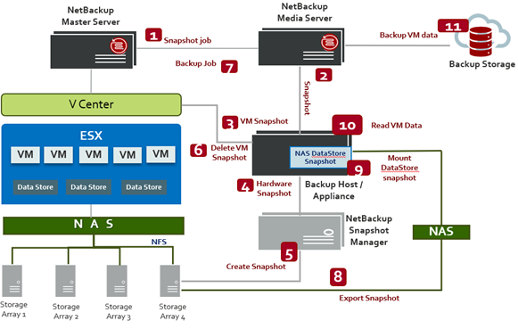

# TÌM HIỂU VỀ NETBACKUP
## Khái niệm

## Kiến trúc của NBU

### Chức năng của các thành phần trong mô hình
- **NetBackup Master Server (Primary Server):**
    + Đóng vai trò bộ não điều phối trung tâm.
    + Quản lý chính sách sao lưu (Policies), kích hoạt và giám sát các tiến trình: điều phối tiến trình tạo snapshot (Snapshot job) và tiến trình ghi dữ liệu sao lưu (Backup job).
- **NetBackup Media Server:**
    + Đóng vai trò máy chủ trung chuyển và xử lý luồng dữ liệu.
    + Nhận lệnh từ Master Server, đọc dữ liệu máy ảo từ Datastore snapshot đã được mount và đẩy luồng dữ liệu này vào kho lưu trữ sao lưu (Backup Storage).
- **Backup Host / Appliance:**
    + Hoạt động như một proxy trung gian chuyên trách (thường là một Linux/Windows Server hoặc thiết bị NetBackup Appliance).
    + Giao tiếp với vCenter để tạo/xóa snapshot của máy ảo ở tầng VMware.
    + Là nơi mount bản snapshot của NAS Datastore từ mảng lưu trữ để phục vụ việc trích xuất dữ liệu.
- **NetBackup Snapshot Manager:**
    + Thành phần chuyên dụng tương tác trực tiếp với mảng lưu trữ phần cứng (Storage Arrays) thông qua các plugin/API lưu trữ.
    + Nhận lệnh từ Backup Host để điều khiển hệ thống lưu trữ tạo bản phần cứng snapshot (Hardware Snapshot) của phân vùng NAS/NFS.
- **V Center & Cụm ESXi / Datastores:**
    + Môi trường ảo hóa chứa các máy ảo (VM) đang hoạt động.
    + Các máy ảo này đặt ổ đĩa ảo (VMDK) trên các Data Store định dạng NFS/NAS do hệ thống Storage Arrays cung cấp.
- **Storage Arrays (1, 2, 3, 4):**
    + Các mảng lưu trữ vật lý cung cấp chia sẻ tệp qua giao thức NFS cho ESXi, đồng thời hỗ trợ tính năng tạo phần cứng snapshot cấp độ mảng đĩa.
- **Backup Storage:**
    + Điểm đến cuối cùng của dữ liệu sao lưu (có thể là phân vùng MSDP Dedup Pool, ổ đĩa lưu trữ hoặc Cloud).
### Workflow
Quy trình được đánh số theo đúng trình tự thực thi:
- *Bước 1 (Snapshot job)*: Master Server kích hoạt công việc tạo snapshot theo lịch trình và giao quyền điều phối cho Media Server.
- *Bước 2 (Snapshot)*: Media Server gửi yêu cầu thực hiện snapshot tới Backup Host.
- *Bước 3 (VM Snapshot)*: Backup Host gọi API đến vCenter để tạo một bản snapshot tức thời của máy ảo (VM-level snapshot). Bước này đóng băng dữ liệu máy ảo tạm thời để đảm bảo tính nhất quán (Crash-consistent hoặc Application-consistent).
- *Bước 4 (Hardware Snapshot)*: Sau khi VM đã đóng băng dữ liệu, Backup Host gửi yêu cầu tới NetBackup Snapshot Manager để tạo bản snapshot phần cứng của toàn bộ NAS Datastore.
- *Bước 5 (Create Snapshot)*: NetBackup Snapshot Manager gọi API trực tiếp xuống hệ thống lưu trữ (Storage Array 4) để kích hoạt tính năng Hardware Snapshot của phân vùng lưu trữ NFS đó.
- *Bước 6 (Delete VM Snapshot)*: Ngay sau khi phần cứng snapshot hoàn tất (chỉ mất vài giây), Backup Host lập tức yêu cầu vCenter xóa snapshot của VM. Điều này giải phóng máy ảo khỏi trạng thái snapshot, tránh hiện tượng phình file delta làm chậm hiệu năng VM trên hệ thống vận hành.
- *Bước 7 (Backup Job)*: Master Server khởi chạy giai đoạn sao lưu dữ liệu chính thức qua Media Server.
- *Bước 8 (Export Snapshot)*: Mảng lưu trữ (Storage Array 4) xuất (export) bản Hardware Snapshot của phân vùng NFS vừa tạo ra hệ thống mạng chia sẻ.
- *Bước 9 (Mount DataStore snapshot)*: Backup Host thực hiện mount bản sao lưu NFS Datastore Snapshot này vào hệ điều hành của chính nó.
- *Bước 10 (Read VM Data)*: Media Server đọc dữ liệu của các máy ảo trực tiếp từ bản Datastore Snapshot đã được mount trên Backup Host (hoàn toàn cách ly, không đọc từ cụm ESXi production).   
- *Bước 11 (Backup VM data)*: Media Server thực hiện xử lý (nén, khử trùng lặp) và ghi dữ liệu máy ảo vào đích lưu trữ an toàn (Backup Storage).